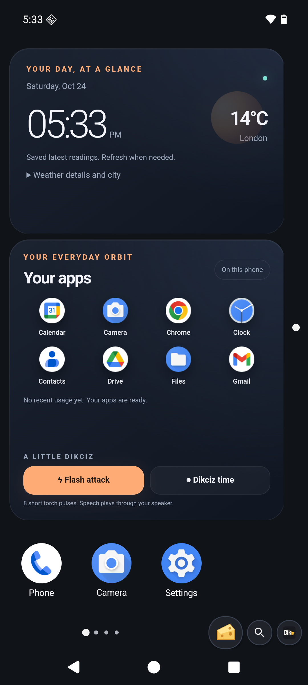

# Dikciz Launcher

[](https://github.com/psyb0t/dikciz-launcher/actions/workflows/pipeline.yml)
[](https://github.com/psyb0t/dikciz-launcher/releases)
[](LICENSE)

*yes, it's dick cheese*

Dikciz is a programmable Android home screen. Build pages from HTML widgets, native app shortcuts and Android widgets, write Lua automations, and control your phone through WebSocket, MCP or HTTP over USB, Wi-Fi or Tailscale.

Your home lives in editable files under `/sdcard/Dikciz/`. The signed release includes scripting, inspection and remote control. Ordinary launcher control needs neither a debug build nor root. Android permissions govern access to the rest of the phone.



## Install it

Download the signed `dikciz-launcher-vX.Y.Z.apk` from [GitHub Releases](https://github.com/psyb0t/dikciz-launcher/releases/latest), or add `https://github.com/psyb0t/dikciz-launcher` to [Obtainium](https://github.com/ImranR98/Obtainium) for updates. On the phone, open `obtainium://add/https://github.com/psyb0t/dikciz-launcher` to add it directly. Dikciz is not published through Google Play.

1. Install the APK and open Dikciz. For an ADB installation, use `adb install -r dikciz-launcher-vX.Y.Z.apk`.
2. Choose Dikciz as Android's default Home app.
3. Tap **Grant file access**, allow shared-storage access in Android, and return to Dikciz. It creates the starter home in `/sdcard/Dikciz/`.
4. Open **Settings**, **Automation**, **Set up full device access** for features that need additional Android access. You choose which permissions and special access to grant. Cross-app UI control needs **Dikciz cross-app automation** enabled in Android Accessibility settings.

Dikciz reopens after an APK update when it is the default Home app or has **Draw over other apps** access. If Android prevents automatic reopening, tap the **Dikciz updated** notification or open the app. This also restarts the remote listeners. See [update recovery](docs/remote-device-control.md#recover-after-an-apk-update).

Release packages use `eu.psyb0t.dikciz.launcher`; debug packages use `eu.psyb0t.dikciz.launcher.debug` and install alongside them. Updates signed with the same key retain app data. Each release includes an APK checksum. Verify the signer with `apksigner verify --print-certs dikciz-launcher-vX.Y.Z.apk`; its certificate SHA-256 fingerprint is:

```text
5F:A2:02:5D:F9:B8:31:C3:56:3E:8D:44:00:88:7A:77:61:86:F1:F6:F4:69:4E:4E:41:04:EF:CF:0E:20:75:15
```

## What the home supports

- Native pages arranged across two axes, each with a fixed grid, stable identity and configurable layout.
- Local HTML, CSS and JavaScript widgets with persistent state, events and the `window.dikciz` bridge.
- Native app shortcuts, app groups and third-party Android AppWidget providers.
- Lua scripts with event subscriptions, typed actions, owner command access and a native script dashboard. Enable only trusted scripts; their command access includes files and shell.
- Themes, fonts, wallpaper, widget appearance, editing locks and a chosen Android Home destination.
- Semantic UI inspection, screenshots, logs, configuration editing and device actions through the remote APIs.

The starter home includes a control deck, notes, an Android Settings shortcut, a Lua script dashboard and a workbench. Lua runs as automation scripts, not as a widget type.

## Navigate and manage the home

Tap the Dikciz mark beside the bottom page rail for the app drawer, widgets, page management and Settings. Swipe up from that rail to open the app drawer. Tap the magnifier to find a page by name or address. A full page refuses another widget rather than overlapping existing items.

The [illustrated user guide](docs/user-guide.md) walks through pages, apps, groups, provider widgets, moving and resizing items, appearance, scripts and recovery.

## Configure it

`/sdcard/Dikciz/config.json` is the root of the public configuration. Pages, widgets, scripts, automation policies, themes, fonts, wallpapers, HTML packages, control settings and logs have their own paths. Valid home and rendering-asset edits reload automatically. Listener address or port changes automatically restart both control planes, including while another Android app is in front.

Use the [configuration guide](docs/dikciz-configuration.md) for file formats and validation. The [scripting tutorial](docs/scripting-tutorial.md) explains Lua events, HTML bridge calls, persistent state and typed actions. Android owns permissions, special access, roles and root approval; an automation policy does not grant Android access.

## Inspect and control it remotely

WebSocket carries commands and persistent events. Streamable HTTP MCP exposes the same command target as tools. Plain HTTP accepts JSON commands at `/v1/automation` on the MCP port. Both default to `127.0.0.1` on the phone, reachable by phone apps and ADB forwarding. For direct access without USB:

1. Connect the phone and controlling computer to the same reachable private network or Tailscale network. Its access policy must allow **computer to phone** traffic on TCP `19001` and `19002`. Being online or answering a Tailscale tunnel ping does not prove application access.
2. On the phone, open **Settings**, **Automation**, **Configure remote bearer authentication**. Set and enable a password. The client reads it from `DIKCIZ_REMOTE_BEARER_TOKEN`; keep it in your secret environment, outside command arguments.
3. Open **Configure control ports**, set **Listen address** to `0.0.0.0`, and save. The [public configuration file](docs/dikciz-configuration.md#control-ports) offers the same setting. Both listeners restart automatically when their endpoints change.
4. Connect from the controlling computer using the phone's reachable hostname or IP and its device ports. `0.0.0.0` is a bind address, not a client destination.

The supplied Python client has no third-party dependencies. Run it from a checkout, replacing `phone.example` with your phone's hostname or IP:

```bash
python3 scripts/dikciz-control.py websocket controlStatus --host phone.example --port 19001 --pretty
python3 scripts/dikciz-control.py mcp-tools --host phone.example --port 19002 --pretty
python3 scripts/dikciz-control.py mcp dikciz_snapshot --host phone.example --port 19002 --pretty
```

| Connection | WebSocket | Streamable HTTP MCP | HTTP commands |
| --- | --- | --- | --- |
| Direct private network | `ws://phone.example:19001/v1/automation` | `http://phone.example:19002/mcp` | `http://phone.example:19002/v1/automation` |
| Lab ADB forwards after `make dikciz-run` | `ws://127.0.0.1:19101/v1/automation` | `http://127.0.0.1:19102/mcp` | `http://127.0.0.1:19102/v1/automation` |

Configure your MCP client's Streamable HTTP URL and bearer header, then initialize and list tools. Read `dikciz://docs/index` through MCP resources for short guides and task recipes, fetched one section at a time. The [resource guide](docs/mcp-resources.md) covers discovery and CLI reads. Direct access needs no USB, ADB or emulator. The endpoints do not provide TLS themselves; use a trusted private network or an encrypted VPN. `0.0.0.0` listens on all IPv4 interfaces, including Wi-Fi, subject to network routing and filtering.

The [connection walkthrough](docs/automation-control.md#connect-without-usb) covers setup, troubleshooting and ADB alternatives. Both protocols reject browser origins outside HTTP or HTTPS loopback pages. Native clients can omit `Origin`. Network access, bearer authentication and Android permissions are separate checks. Shell commands request root by default; pass `root: false` for Dikciz's app sandbox. Commands accept `autoRequestPermissions: true` to show owner review when Android access is missing. Use `requestDeviceAccess` or MCP `dikciz_request_device_access` to ask for one capability directly; responses report permission state, notification delivery and instructions. See [permission requests](docs/automation-control.md#request-missing-android-access).

Browse and transfer any files Android lets Dikciz access, upload standalone APKs and request installation, or run Android shell commands and read their output and exit status. Shell commands default to a 30-second timeout and accept per-request timeout and output-size options. Android controls installation permission and confirmation. The [files, APKs and shell guide](docs/files-and-apks.md) covers commands, binary transfers and final installation status.

Inspect the actual serving package and version with `deviceInfo`, inspect another installed package with `packageInfo`, and use `restart` for an acknowledged launcher restart that preserves configuration and reconnects without killing the process. `launcherHandoff` switches between installed release and debug controllers after checking target access. `displayScreenshot` captures other apps through enabled Accessibility on Android 11+. The [remote device guide](docs/remote-device-control.md) covers these controls, port-conflict recovery and which operations require Android access or root.

## Logs and failure reporting

Dikciz writes daily UTC JSON Lines files under `/sdcard/Dikciz/logs/`. **Settings**, **Configure logging** selects DEBUG, INFO, WARN or ERROR and retention from 1 to 90 days. Defaults are INFO and seven days; changes apply immediately. Successful app launches stay in the logs without a popup. Read script results and failures in the dashboard, Settings log viewer, WebSocket `scriptLogs` or MCP `dikciz_script_logs`. A queued event does not prove an action succeeded. The [logging reference](docs/dikciz-configuration.md#logs) covers redaction, limits and failure notifications.

## Run it

Source development uses Docker, Make and Git. Clone this repository and run commands from its root. The Makefile pins [Android Lab](https://github.com/psyb0t/android-lab), which provides the Docker build tools and private Android emulator. If its images are missing, read the [Android SDK license](https://developer.android.com/studio/terms) before accepting it for the local build:

```bash
ANDROID_LAB_ACCEPT_ANDROID_LICENSES=yes make build
make dikciz-run
```

Open the shared emulator at `http://127.0.0.1:61326/vnc.html?autoconnect=true&resize=scale`. `make dikciz-run` installs the debug package, grants file access on that isolated emulator, selects it as Home and preserves existing configuration. `make dikciz-reset` clears only Dikciz and its public files there. Keep `.android-lab/`, which holds the emulator disk, cache, signing identity and artifacts.

`make help` lists supported operations. `make status` inspects the stack; `make stop` stops it while preserving its saved phone. Tool containers use up to 10 host CPUs. Override `ANDROID_LAB_TOOL_CPU_LIMIT` and `ANDROID_LAB_GRADLE_MAX_WORKERS` for a smaller build budget. Images are built locally with the pinned installer after SDK license acceptance.

## Fossify source updates

The complete Fossify source remains the maintained Android base. Dikciz code lives under `app/src/dikciz/` and combined source sets. Use `make dikciz-upstream-compare`, then `make dikciz-upstream-refresh-dry-run`, with `DIKCIZ_UPSTREAM_DIR` set to the selected upstream checkout. Replacement requires `DIKCIZ_UPSTREAM_REFRESH=1`, a newer upstream marker and a verified backup. The [Fossify integration map](.fossify/README.md) owns the full procedure and source boundaries.

## Verification

Use `make lint` for script checks and Android lint on minified Dikciz, `make gradle GRADLE_TASK=:app:assembleDikcizDebug` for a focused build and the relevant target from [the test guide](tests/README.md) for live behavior. `make dikciz-test` runs the broad shared-emulator suite. `make dikciz-test-minified-lua` verifies Lua execution and failure reporting with release shrinking enabled. Tests leave the shared emulator on the current bundled starter home.

CI runs `make lint` as a required code job step. Android lint errors fail that job and block the dependent release job. The minified lint task checks the Dikciz source set. `make app-lint` separately checks the upstream-compatible core.

A version tag builds the signed APK and checksum in CI through `make release-apk`. That target verifies the published signing certificate and the version from `VERSION`. Its keystore and signing secrets stay outside tracked source. The [release history](docs/changelog.md) records user-visible changes.

## Source map

| Guide | Covers |
| --- | --- |
| [User guide](docs/user-guide.md) | Installation, Android access, navigation and native editing, with screenshots. |
| [Configuration](docs/dikciz-configuration.md) | Public files, validation, reload behavior, themes and logs. |
| [Scripting](docs/scripting-tutorial.md) | Lua, HTML, events, policies and typed actions. |
| [Automation control](docs/automation-control.md) | Direct connections, ADB forwarding, authentication, WebSocket, MCP and HTTP. |
| [Files, APKs and shell](docs/files-and-apks.md) | Browse, upload, download, install APKs and read CLI results. |
| [Dikciz source](app/src/dikciz/README.md) | Product architecture and implementation boundaries. |
| [Scripts](scripts/README.md), [tests](tests/README.md), [contributing](CONTRIBUTING.md) | Build tooling, verification and change boundaries. |

## Agent use

The [Dikciz Launcher skill](.agents/skills/dikciz-launcher/SKILL.md) covers installation and operation through ADB or direct network control. Its [setup reference](.agents/skills/dikciz-launcher/references/setup.md) and [capability reference](.agents/skills/dikciz-launcher/references/capabilities.md) describe connection checks and available actions. The [Dikciz Android Lab skill](.agents/skills/dikciz-android-lab/SKILL.md) covers source builds and emulator work. Tag publishing selects only `dikciz-launcher` for ClawHub and publishes no plugin bundle.

## Upstream

Dikciz is based on [Fossify Launcher](https://github.com/FossifyOrg/Launcher) and distributed under the [GNU General Public License v3.0](LICENSE).
