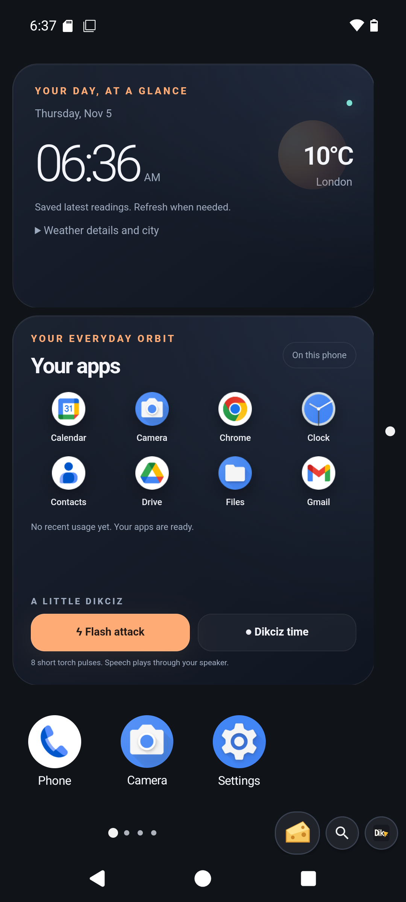
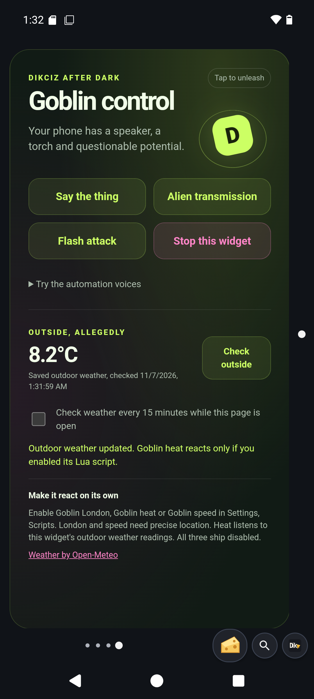
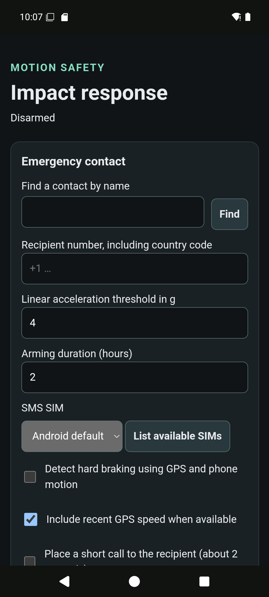
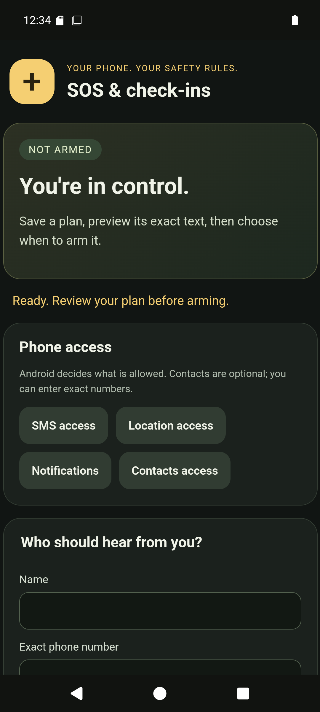
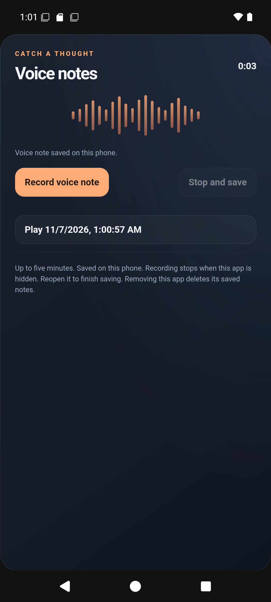
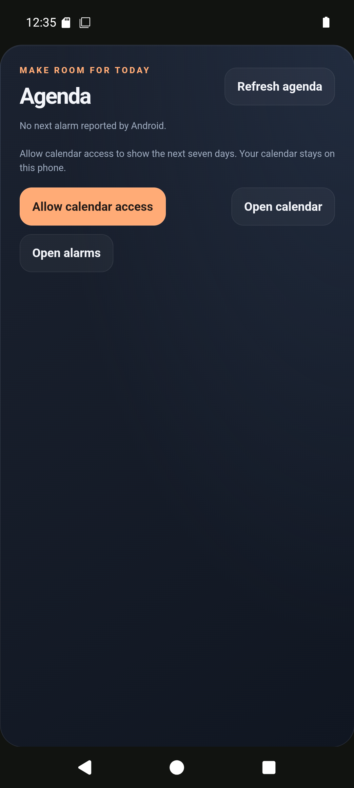
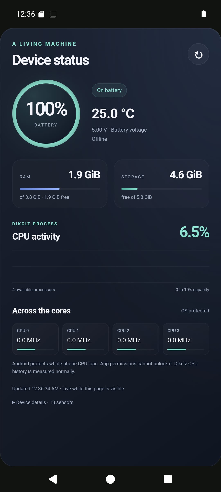
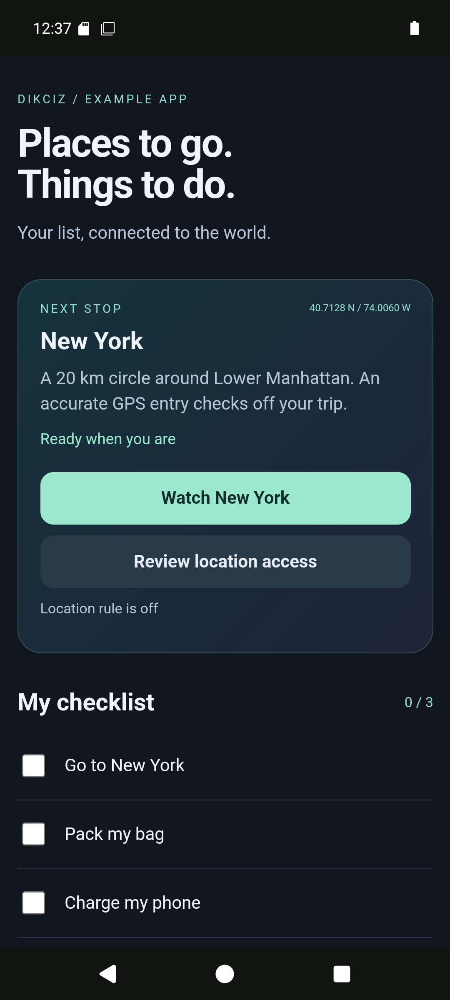
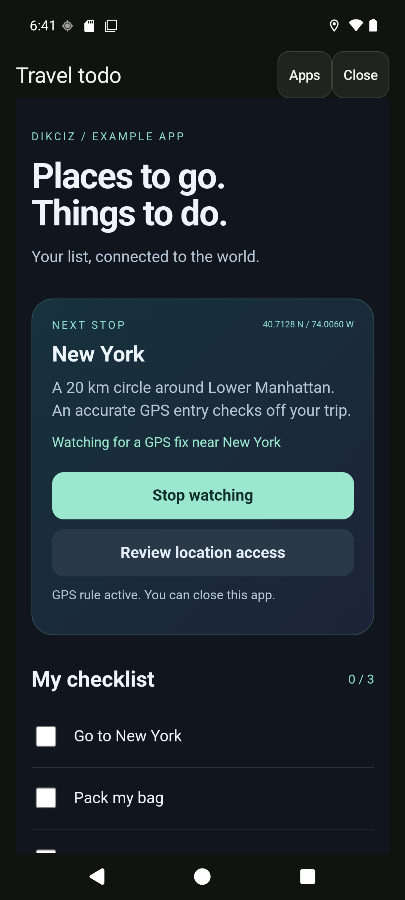
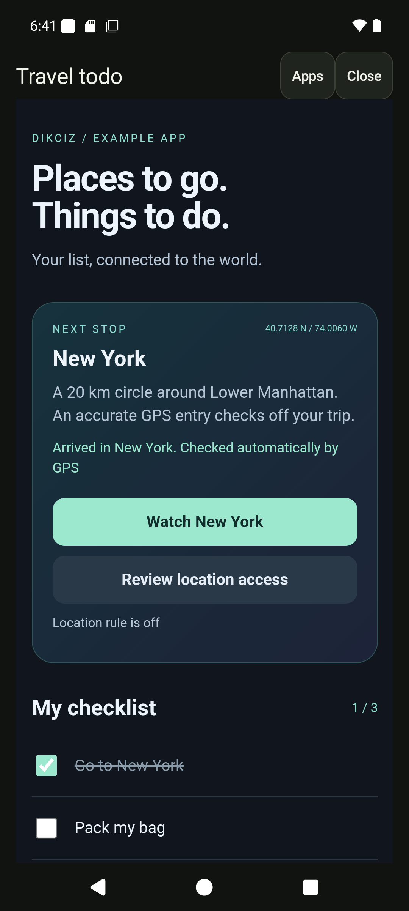

# Dikciz Launcher

[](https://github.com/psyb0t/dikciz-launcher/actions/workflows/pipeline.yml)
[](https://github.com/psyb0t/dikciz-launcher/releases)
[](LICENSE)

*yes, it's dick cheese*

Dikciz is a programmable Android launcher built on [Fossify Launcher](https://github.com/FossifyOrg/Launcher). Put a clock on your home screen, hold it down, and edit the damn clock. It's HTML, CSS and JavaScript. It lives alongside your normal Android widgets, shortcuts and app folders.

Your layout, widget source and scripts live under `/sdcard/Dikciz/`. Write Lua or JavaScript to react to phone events, or ask the built-in assistant to make something for you. Want to drive the phone from your laptop? The same tools are available over [MCP](https://modelcontextprotocol.io/), HTTP and WebSocket. All of that ships in the signed APK and uses the Android permissions you grant.

## Who this is for

For anyone who's ever thought "why the fuck do I need an app for that?" Build a todo list that checks off "go to New York" when you get there. Or make your phone say "peen goes in vageen", flash the torch like Christmas and play alien noises. The goblin stuff comes in the box.

[Install the APK](#install-it) to use it. [Build from source](#run-it) to work on the launcher.

<p align="center">


</p>

These are two of the four starter pages. **Tools** has an agenda and voice notes. **Device** shows battery, CPU, memory and storage. [See the full starter home](https://psyb0t.github.io/dikciz-launcher/starter-home/).

## Contents

| Use Dikciz | Build and connect |
| --- | --- |
| [Install](#install-it), [navigate Home](#navigate-and-manage-the-home), [configure it](#configure-it) | [Build from source](#run-it), [Fossify source updates](#fossify-source-updates), [verification](#verification) |
| [Bundled apps](#bundled-apps), [widgets and scripts](#bundled-widgets-and-scripts), [chat](#chat-with-your-phone) | [Build your first app](#build-your-first-app), [remote control](#inspect-and-control-it-remotely), [agent integrations](#agent-integrations) |
| [Safety and devices](#safety-journeys-and-devices), [activity and backups](#activity-recovery-and-backups) | [Documentation](#documentation), [Android capabilities](#android-capabilities), [licenses](#upstream) |

## Install it

Download the signed `dikciz-launcher-vX.Y.Z.apk` from [GitHub Releases](https://github.com/psyb0t/dikciz-launcher/releases/latest), or add `https://github.com/psyb0t/dikciz-launcher` to [Obtainium](https://github.com/ImranR98/Obtainium) for updates. On the phone, open `obtainium://add/https://github.com/psyb0t/dikciz-launcher` to add it directly. Dikciz is not published through Google Play.

1. Install the APK and open Dikciz. For an ADB installation, use `adb install -r dikciz-launcher-vX.Y.Z.apk`.
2. Choose Dikciz as Android's default Home app.
3. Tap **Grant file access**, allow shared-storage access in Android, and return to Dikciz. It creates the starter home in `/sdcard/Dikciz/`.
4. Open **Settings**, **Getting started** for Android access, widget templates, assistant setup and remote control. Choose **Review Android access** for features that need additional grants. You choose which permissions and special access to grant. Cross-app UI control needs **Dikciz cross-app automation** enabled in Android Accessibility settings.

Dikciz reopens after an APK update when it is the default Home app or has **Draw over other apps** access. If Android prevents automatic reopening, tap the **Dikciz updated** notification or open the app. This also restarts the remote listeners. See [update recovery](https://psyb0t.github.io/dikciz-launcher/remote-device-control/#recover-after-an-apk-update).

Release packages use `eu.psyb0t.dikciz.launcher`; debug packages use `eu.psyb0t.dikciz.launcher.debug` and install alongside them. Updates signed with the same key retain app data. Each release includes an APK checksum. Verify the signer with `apksigner verify --print-certs dikciz-launcher-vX.Y.Z.apk`; its certificate SHA-256 fingerprint is:

```text
5F:A2:02:5D:F9:B8:31:C3:56:3E:8D:44:00:88:7A:77:61:86:F1:F6:F4:69:4E:4E:41:04:EF:CF:0E:20:75:15
```

## What the home supports

- Home pages with editable grids, native shortcuts and folders, Android widgets, themes, fonts and wallpapers.
- HTML widgets and [custom apps](https://psyb0t.github.io/dikciz-launcher/custom-apps/) with editable HTML, CSS and JavaScript, saved state and phone events.
- Lua and [background JavaScript](https://psyb0t.github.io/dikciz-launcher/background-javascript/) for rules that react to events and timers. Enabled scripts can call phone tools, including files and shell.
- UI inspection, screenshots, logs and configuration editing over the [remote APIs](#inspect-and-control-it-remotely).

## Bundled widgets and scripts

Add a widget from the picker, then edit its HTML, CSS, JavaScript and state. The [bundled catalog](https://psyb0t.github.io/dikciz-launcher/starter-home/#complete-bundled-widget-catalog) lists all 19 templates, including weather, an app launcher, live sensors, BTC/USD and a vehicle console.

Want your phone to yell when you reach London? That's one of six Lua scripts you can switch on. The others cover battery reminders, screen locking, hot weather and GPS speed. They all start disabled. [See setup and triggers](https://psyb0t.github.io/dikciz-launcher/starter-home/#optional-lua-utilities).

## Navigate and manage the home

Tap **All Android apps** or swipe up from the lower part of Home to open the app drawer. The Dikciz mark opens widgets, page management and Settings. Tap the magnifier to find a page by name or address. Hold one shortcut over another until the target grows, then drop it to make a folder. Tap the folder to open it right at the tile. You can also ask a writable chat to put your installed travel apps in a folder on main Home. If the page is full, make room or pick another page.

The [illustrated user guide](https://psyb0t.github.io/dikciz-launcher/user-guide/) walks through pages, apps, groups, provider widgets, moving and resizing items, appearance, scripts and recovery.

## Chat with your phone

Tap the cheese beside the launcher controls. A count on the cheese takes you straight to the unread chats. Use **Chats** to resume a conversation and **Chat options** to connect an OpenAI-compatible or Anthropic-compatible provider. Each conversation chooses its own model, reasoning level and token budget.

Ask the cheese to make you a widget or explain the app on screen. Give it an event rule if you want it to react on its own. Read-only mode blocks writes. When chat is in the background, its notification shows progress and offers **Stop**. [Set up chat and its tools](https://psyb0t.github.io/dikciz-launcher/embedded-chat/) or add [skills, named agents and rules](https://psyb0t.github.io/dikciz-launcher/assistant-library/) under `/sdcard/Dikciz/assistant/`.

## Safety, journeys and devices

Open **Settings**, **Safety, journeys and devices** for inactive contact plans, opt-in missed check-ins/SOS, geofences, recorded routes, retained Bluetooth/USB/NFC connections, image OCR/barcodes/PDFs, Health Connect records and Android-approved Wi-Fi flows. All use the shared phone APIs. [Read the setup and limits](https://psyb0t.github.io/dikciz-launcher/companion/) before enabling background work. The optional Vehicle console template reads a paired ELM327 adapter. Chat also offers five [read-only routines](https://psyb0t.github.io/dikciz-launcher/assistant-routines/).

## Bundled apps

**Dikciz > Dikciz apps** opens complete editable apps. [Impact response](https://psyb0t.github.io/dikciz-launcher/apps/impact-response/), [SOS and check-ins](https://psyb0t.github.io/dikciz-launcher/apps/sos-check-ins/), [Voice notes](https://psyb0t.github.io/dikciz-launcher/apps/voice-notes/), [Agenda and alarms](https://psyb0t.github.io/dikciz-launcher/apps/agenda-and-alarms/), [Device status](https://psyb0t.github.io/dikciz-launcher/apps/device-status/) and [Travel todo](https://psyb0t.github.io/dikciz-launcher/apps/travel-todo/) ship with Dikciz. Impact Response opens disarmed. It can warn on phone motion and text one chosen contact after a cancellation countdown. Each app has its own Android task and Recents entry, without a manager toolbar. Create or import your own. Apps share the Android access granted to Dikciz. [The app guide](https://psyb0t.github.io/dikciz-launcher/custom-apps/) covers source, state, events, timers, dimmed alerts and reusable archives.

<p align="center">
<a href="https://psyb0t.github.io/dikciz-launcher/apps/impact-response/"></a>
<a href="https://psyb0t.github.io/dikciz-launcher/apps/sos-check-ins/"></a>
<a href="https://psyb0t.github.io/dikciz-launcher/apps/voice-notes/"></a>
</p>

<p align="center">
<a href="https://psyb0t.github.io/dikciz-launcher/apps/agenda-and-alarms/"></a>
<a href="https://psyb0t.github.io/dikciz-launcher/apps/device-status/"></a>
<a href="https://psyb0t.github.io/dikciz-launcher/apps/travel-todo/"></a>
</p>

## Build your first app

Open **Dikciz > Dikciz apps > Travel todo** for a complete editable app. Add tasks, then opt into **Watch New York**. An accurate GPS entry checks off **Go to New York**, even while its UI is closed. A custom event can check off another task. The [step-by-step tutorial](https://psyb0t.github.io/dikciz-launcher/todo-app-tutorial/) explains every source file, permission, event and saved-state change; the [complete reference source](app/src/dikciz/assets/apps/travel-todo/) ships in the APK.

<p align="center">


</p>

## Configure it

`/sdcard/Dikciz/config.json` is the root of the public configuration. Pages, widgets, scripts, automation policies, themes, fonts, wallpapers, HTML packages, control settings and logs have their own paths. Valid home and rendering-asset edits reload automatically. Listener address or port changes automatically restart both control planes, including while another Android app is in front.

Use the [configuration guide](https://psyb0t.github.io/dikciz-launcher/dikciz-configuration/) for file formats and validation. The [scripting tutorial](https://psyb0t.github.io/dikciz-launcher/scripting-tutorial/) explains Lua events, HTML bridge calls, persistent state and typed actions. Android owns permissions, special access, roles and root approval; an automation policy does not grant Android access.

## Inspect and control it remotely

WebSocket carries commands and live events on port `19001`. Streamable HTTP MCP and JSON commands share port `19002`. The listeners start on the phone's loopback address. Use ADB forwarding over USB or connect directly over a private network.

For Wi-Fi or Tailscale access, open **Settings**, **Automation**, **Configure remote bearer authentication**. Enable authentication and create a [token with the grants your client needs](https://psyb0t.github.io/dikciz-launcher/remote-access-tokens/). In **Configure control ports**, set the listen address to `0.0.0.0`. Connect to the phone's private hostname or IP. The listeners restart after you save. Use a trusted private network or encrypted VPN because the listeners serve plain HTTP and WebSocket. [Full connection walkthrough](https://psyb0t.github.io/dikciz-launcher/automation-control/#connect-without-usb).

From the checkout, set `DIKCIZ_REMOTE_BEARER_TOKEN` in the client environment and replace `phone.example` with the phone's hostname:

```bash
python3 scripts/dikciz-control.py mcp-tools --host phone.example --port 19002 --pretty
```

| API | Endpoint |
| --- | --- |
| WebSocket | `ws://phone.example:19001/v1/automation` |
| Streamable HTTP MCP | `http://phone.example:19002/mcp` |
| HTTP commands | `http://phone.example:19002/v1/automation` |

Start with the [command reference](https://psyb0t.github.io/dikciz-launcher/command-reference/) or search help on the phone with `dikciz_search_query`. Use the [remote device guide](https://psyb0t.github.io/dikciz-launcher/remote-device-control/) for version checks, screenshots and restart, and the [files guide](https://psyb0t.github.io/dikciz-launcher/files-and-apks/) for transfers, APKs and shell commands.

## Android capabilities

Phone tools cover contacts, SMS, call history, calendars, notifications, location, sensors, camera, audio, speech, Bluetooth, NFC, USB and Wi-Fi. Calls use Android APIs and remain subject to Android permissions and hardware support. [Find the right tool and its access requirements](https://psyb0t.github.io/dikciz-launcher/capability-coverage/). The [SDK bridge](https://psyb0t.github.io/dikciz-launcher/android-sdk/) exposes additional Android SDK classes and methods.

## Activity, recovery and backups

Browse events and test rules in **Dikciz > Automation debugger**. Open **Settings > Activity & resources** for command history, resource usage and controls to pause background work. [Debugger guide](https://psyb0t.github.io/dikciz-launcher/automation-debugger/) · [Activity guide](https://psyb0t.github.io/dikciz-launcher/operations/).

[Encrypted backups](https://psyb0t.github.io/dikciz-launcher/backups/) can save Home, scripts, apps, assistant instructions and chat history. Preview the data before restoring it.

## Logs and failure reporting

Dikciz writes daily UTC JSON Lines files under `/sdcard/Dikciz/logs/`. **Settings**, **Configure logging** selects DEBUG, INFO, WARN or ERROR and retention from 1 to 90 days. Defaults are INFO and seven days; changes apply immediately. Successful app launches stay in the logs without a popup. Read script results and failures in the dashboard, Settings log viewer, WebSocket `scriptLogs` or MCP `dikciz_script_logs`. If a script says it queued an event and nothing bloody happened, check the action result next. The [logging reference](https://psyb0t.github.io/dikciz-launcher/dikciz-configuration/#logs) covers redaction, limits and failure notifications.

## Run it

Source development uses Docker, Make and Git. Clone this repository and run commands from its root. The Makefile pins [Android Lab](https://github.com/psyb0t/android-lab), which provides the Docker build tools and private Android emulator. If its images are missing, read the [Android SDK license](https://developer.android.com/studio/terms) before accepting it for the local build:

```bash
ANDROID_LAB_ACCEPT_ANDROID_LICENSES=yes make build
make dikciz-run
```

The [source development guide](https://psyb0t.github.io/dikciz-launcher/source-development/) covers the emulator, persistent state, resource budgets, source boundaries and release verification. `make help` lists supported operations.

## Fossify source updates

The complete Fossify source remains the maintained Android base. Dikciz code lives under `app/src/dikciz/` and combined source sets. Use `make dikciz-upstream-compare`, then `make dikciz-upstream-refresh-dry-run`, with `DIKCIZ_UPSTREAM_DIR` set to the selected upstream checkout. Replacement requires `DIKCIZ_UPSTREAM_REFRESH=1`, a newer upstream marker and a verified backup. The [Fossify integration map](.fossify/README.md) owns the full procedure and source boundaries.

## Verification

Run `make lint` for script, website and minified Android lint checks, then use the focused scenario from [the test guide](tests/README.md). Main pushes run build, lint and tooling checks; version tags wait for that commit to pass before publishing the signed APK. The [development guide](https://psyb0t.github.io/dikciz-launcher/source-development/) covers verification and release artifacts.

## Documentation

| I want to | Read |
| --- | --- |
| Set up the phone and arrange Home | [Illustrated user guide](https://psyb0t.github.io/dikciz-launcher/user-guide/) |
| Learn by building | [Tutorials](https://psyb0t.github.io/dikciz-launcher/tutorial/) · [Recipes](https://psyb0t.github.io/dikciz-launcher/recipes/) |
| Edit saved files or write code | [Configuration](https://psyb0t.github.io/dikciz-launcher/dikciz-configuration/) · [Developer manual](https://psyb0t.github.io/dikciz-launcher/developer-manual/) |
| Connect a client or inspect a request | [Automation control](https://psyb0t.github.io/dikciz-launcher/automation-control/) · [Command reference](https://psyb0t.github.io/dikciz-launcher/command-reference/) |
| Find a guide or contribute code | [All documentation](https://psyb0t.github.io/dikciz-launcher/) · [Contributing](CONTRIBUTING.md) |

## Agent integrations

The [Dikciz Launcher skill](.agents/skills/dikciz-launcher/SKILL.md) covers installation and operation. Claude Code and Codex manifests under `.agents/` package those instructions. The server runs in your installed Android APK; supply its reachable `/mcp` URL and an access token. Connect Codex directly, or load the local Claude plugin from this checkout:

```bash
codex mcp add dikciz --url http://phone.example:19002/mcp --bearer-token-env-var DIKCIZ_REMOTE_BEARER_TOKEN
claude --plugin-dir .agents
```

The [agent integration guide](https://psyb0t.github.io/dikciz-launcher/agent-integrations/) covers client setup, secrets and plugin configuration. The [Android Lab skill](.agents/skills/dikciz-android-lab/SKILL.md) covers source builds and emulator work. After APK release, tag publishing selects only the operating skill for ClawHub. Marketplace listing is separate from the phone connection.

## Upstream

Dikciz and its Fossify base are distributed under the [GNU General Public License v3.0](LICENSE). Bundled Google ML Kit models have separate [terms and metrics disclosures](https://psyb0t.github.io/dikciz-launcher/dependency-licenses/).
