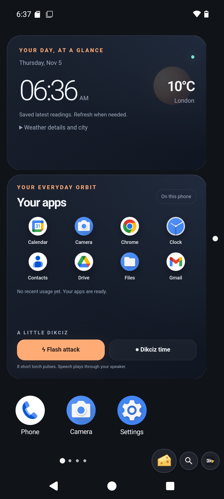
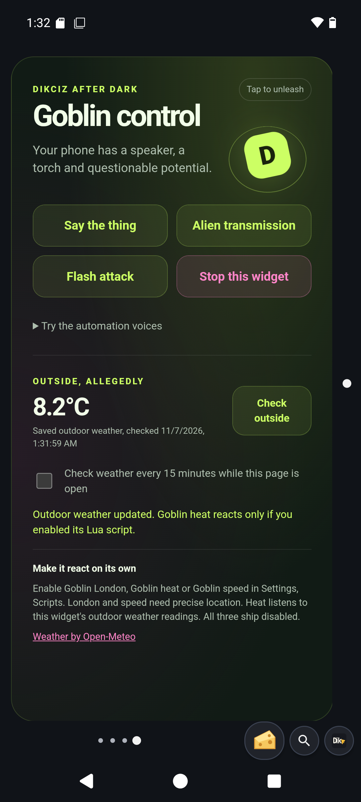
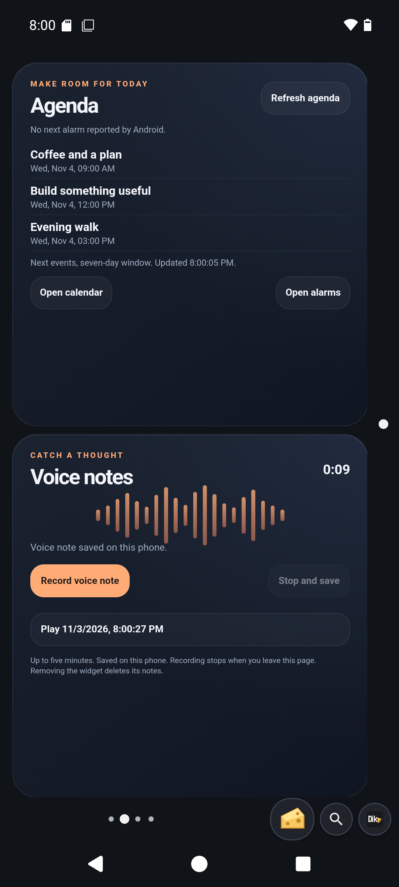
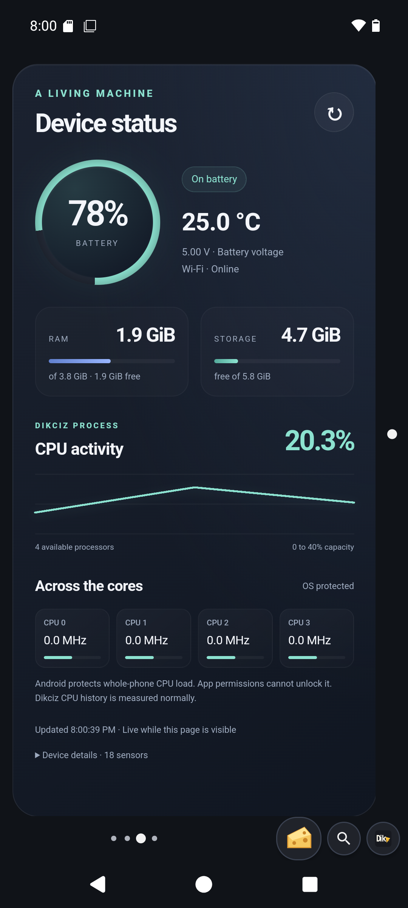
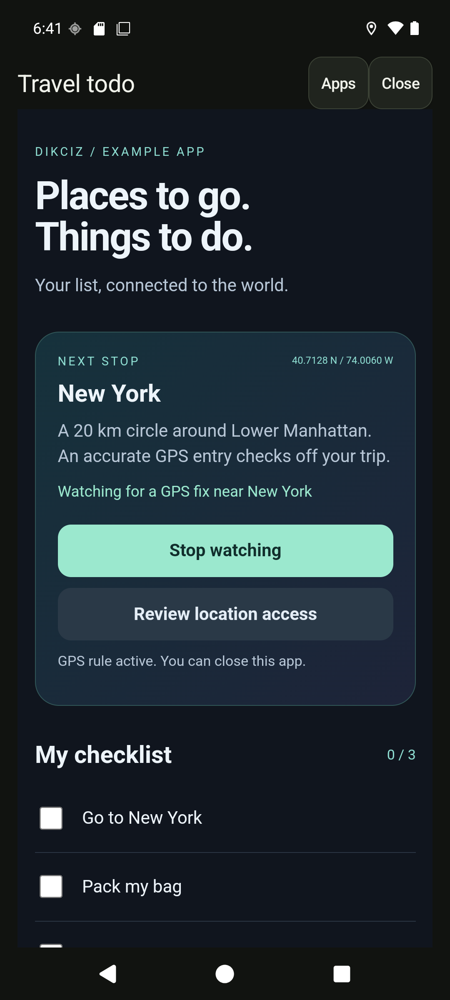
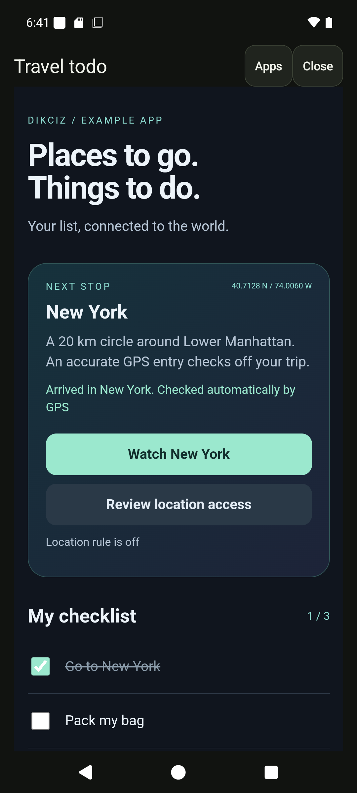

# Dikciz Launcher

[](https://github.com/psyb0t/dikciz-launcher/actions/workflows/pipeline.yml)
[](https://github.com/psyb0t/dikciz-launcher/releases)
[](LICENSE)

*yes, it's dick cheese*

Dikciz is a programmable Android home screen. Build pages from HTML widgets, native app shortcuts and Android widgets, write Lua or background JavaScript automations, and control your phone through WebSocket, MCP or HTTP over USB, Wi-Fi or Tailscale.

Your home lives in editable files under `/sdcard/Dikciz/`. The signed release includes scripting, inspection and remote control. Ordinary launcher control needs neither a debug build nor root. Android permissions govern access to the rest of the phone.

## Who this is for

**TL;DR: Your phone, your controls.** Dikciz is for developers, tinkerers and anyone who wants to program their phone: build a home screen in HTML/CSS/JavaScript, automate events with Lua or JavaScript, and let their own AI use the phone through MCP.

Also for goblins who want their phone to say "peen goes in vageen", flash the torch like Christmas and play alien noises. Speech, audio, lights and SMS are programmable too. Build something useful, something ridiculous, or both.

You choose the model provider, scripts, permissions and network access. The built-in assistant and external clients use the same phone tools. Android's permission and hardware limits still apply.

<p align="center">


</p>
<p align="center">


</p>

Current four-page starter on the emulator, with live London weather, sample calendar entries, a saved voice note and a configured battery level. Device counters reflect what Android exposes to the app.

## Contents

| Start here | Details |
| --- | --- |
| [Who this is for](#who-this-is-for) | [What you can build](#what-the-home-supports), [AI chat](#chat-with-your-phone) |
| [Build your first app](#build-your-first-app) | [GPS todo walkthrough](https://psyb0t.github.io/dikciz-launcher/todo-app-tutorial/) |
| [Bundled widgets and scripts](#bundled-widgets-and-scripts) | [Complete catalog](https://psyb0t.github.io/dikciz-launcher/starter-home/) |
| [Install](#install-it) | [Home features](#what-the-home-supports), [navigation](#navigate-and-manage-the-home) |
| [On-device chat](#chat-with-your-phone) | [Provider setup, tools and event rules](https://psyb0t.github.io/dikciz-launcher/embedded-chat/) |
| [Configuration](#configure-it) | [Remote control](#inspect-and-control-it-remotely), [Android capabilities](#android-capabilities), [logs](#logs-and-failure-reporting) |
| [Build and run](#run-it) | [Fossify updates](#fossify-source-updates), [verification](#verification) |
| [Activity and backups](#activity-recovery-and-backups) | [Operations](https://psyb0t.github.io/dikciz-launcher/operations/), [encrypted restore](https://psyb0t.github.io/dikciz-launcher/backups/), [live images and speech](https://psyb0t.github.io/dikciz-launcher/visual-streams/) |
| [Documentation](#documentation) | [Agent integrations](#agent-integrations), [upstream](#upstream) |

## Install it

Download the signed `dikciz-launcher-vX.Y.Z.apk` from [GitHub Releases](https://github.com/psyb0t/dikciz-launcher/releases/latest), or add `https://github.com/psyb0t/dikciz-launcher` to [Obtainium](https://github.com/ImranR98/Obtainium) for updates. On the phone, open `obtainium://add/https://github.com/psyb0t/dikciz-launcher` to add it directly. Dikciz is not published through Google Play.

1. Install the APK and open Dikciz. For an ADB installation, use `adb install -r dikciz-launcher-vX.Y.Z.apk`.
2. Choose Dikciz as Android's default Home app.
3. Tap **Grant file access**, allow shared-storage access in Android, and return to Dikciz. It creates the starter home in `/sdcard/Dikciz/`.
4. Open **Settings**, **Getting started** for Android access, widget templates, assistant setup and remote control. Choose **Review Android access** for features that need additional grants. You choose which permissions and special access to grant. Cross-app UI control needs **Dikciz cross-app automation** enabled in Android Accessibility settings.

Dikciz reopens after an APK update when it is the default Home app or has **Draw over other apps** access. If Android prevents automatic reopening, tap the **Dikciz updated** notification or open the app. This also restarts the remote listeners. See [update recovery](https://psyb0t.github.io/dikciz-launcher/remote-device-control/#recover-after-an-apk-update).

Release packages use `eu.psyb0t.dikciz.launcher`; debug packages use `eu.psyb0t.dikciz.launcher.debug` and install alongside them. Updates signed with the same key retain app data. Each release includes an APK checksum. Verify the signer with `apksigner verify --print-certs dikciz-launcher-vX.Y.Z.apk`; its certificate SHA-256 fingerprint is:

```text
5F:A2:02:5D:F9:B8:31:C3:56:3E:8D:44:00:88:7A:77:61:86:F1:F6:F4:69:4E:4E:41:04:EF:CF:0E:20:75:15
```

## What the home supports

- Native pages arranged across two axes, each with a fixed grid, stable identity and configurable layout.
- Local HTML, CSS and JavaScript widgets with persistent state, events and the `window.dikciz` bridge.
- [Custom apps](https://psyb0t.github.io/dikciz-launcher/custom-apps/) with complete editable HTML/CSS/JavaScript interfaces, Lua or JavaScript backends, independent state, event subscriptions and native timers.
- Native app shortcuts, app groups and third-party Android AppWidget providers.
- Lua and [background JavaScript](https://psyb0t.github.io/dikciz-launcher/background-javascript/) scripts with event subscriptions, typed actions, owner command access and a native script dashboard. Enable only trusted scripts; their command access includes files and shell.
- Themes, fonts, wallpaper, widget appearance, editing locks and a chosen Android Home destination.
- Semantic UI inspection, screenshots, logs, configuration editing and device actions through the remote APIs.

The starter combines everyday launcher controls with programmable widgets. **Home** has clock/weather, app icons ranked by optional usage history, and native Phone, Camera, Settings and app-store shortcuts along the bottom. **Tools** has agenda and voice notes. **Device** has a live battery gauge, memory/storage bars and CPU charts. Tap the home quick actions for a short torch pulse sequence or speech; neither starts automatically. Each HTML document remains separately editable. The HTML library offers complete editable WebView templates, including system metrics and BTC/USD with economic news. Save customized documents to reuse them. Six Lua examples start disabled, including GPS London announcements, outdoor heat commentary and speed warnings. The **Goblin** page adds tap-operated speech, torch pulses and alien sounds. The [complete bundled catalog](https://psyb0t.github.io/dikciz-launcher/starter-home/#complete-bundled-widget-catalog) describes every template and script. See the [starter home guide](https://psyb0t.github.io/dikciz-launcher/starter-home/).

## Bundled widgets and scripts

The nineteen complete HTML templates cover **Time and weather**, **Most used apps**, **Agenda**, **Voice notes**, **Device status**, **Goblin control**, **Home dashboard**, **System dashboard**, **Live sensors**, **BTC and economic news**, **Clock and search**, **Find an app**, **Quick note**, **Android app settings**, **Android display settings**, **Lock screen**, **Post a notification**, **Dikciz diagnostics** and **Vehicle console**. Add copies from the widget picker and edit their full HTML, CSS, JavaScript and saved state. The [complete catalog](https://psyb0t.github.io/dikciz-launcher/starter-home/#complete-bundled-widget-catalog) explains every template and its data sources.

Six Lua examples ship disabled: **Low battery reminder**, **Unplug at 80 percent**, **Lock screen on demand**, **Goblin London**, **Goblin heat** and **Goblin speed**. The goblin rules announce London arrival, complain above 35 Celsius outdoors, and yell above 80 km/h GPS speed. Their saved cooldowns and rearm thresholds prevent constant repetition. The Goblin page lets you preview the voices, say "peen goes in vageen", flash the torch and play synthesized alien sounds. Enable scripts individually in Settings; read [triggers, permissions and weather setup](https://psyb0t.github.io/dikciz-launcher/starter-home/#optional-lua-utilities).

## Navigate and manage the home

Tap the Dikciz mark beside the bottom page rail for the app drawer, widgets, page management and Settings. Swipe up from that rail to open the app drawer. Tap the magnifier to find a page by name or address. A full page refuses another widget rather than overlapping existing items.

The [illustrated user guide](https://psyb0t.github.io/dikciz-launcher/user-guide/) walks through pages, apps, groups, provider widgets, moving and resizing items, appearance, scripts and recovery.

## Chat with your phone

Tap the cheese beside the launcher controls for an on-device assistant. Add an OpenAI-compatible or Anthropic-compatible provider connection once, choose models from its API-backed chat dropdown, keep independent model/token/reasoning settings for each conversation, and let it discover the same phone MCP tools used by external agents. Read-only mode hides mutating tools and blocks direct write calls in the executor. The panel streams Markdown, expands from half screen, and can hide while the agent uses another app. Its quiet **Open chat** notification also opens it over any app while the assistant is idle. Event rules can wake a conversation in the background. A live notification shows its activity, reopens the exact chat on a tap and offers **Stop**. SQLite keeps full transcripts; choose old-exchange trimming or summary compaction with an output reserve. Use **Make me a widget** to generate a complete widget on the current page, or **Explain this screen** to capture the screen behind chat and ask for a read-only explanation. Read [chat setup and controls](https://psyb0t.github.io/dikciz-launcher/embedded-chat/).

## Safety, journeys and devices

Open **Settings**, **Safety, journeys and devices** for inactive contact plans, opt-in missed check-ins/SOS, geofences, recorded routes, retained Bluetooth/USB/NFC connections, image OCR/barcodes/PDFs, Health Connect records and Android-approved Wi-Fi flows. All use the shared phone APIs. [Read the setup and limits](https://psyb0t.github.io/dikciz-launcher/companion/) before enabling background work. The optional Vehicle console template reads a paired ELM327 adapter. Chat also offers five [read-only routines](https://psyb0t.github.io/dikciz-launcher/assistant-routines/).

**Dikciz**, **Apps** opens complete editable apps. SOS is an ordinary bundled app whose message/check-in logic lives in `/sdcard/Dikciz/apps/sos/main.js`, beside its HTML/CSS/JavaScript UI and state. Voice notes, Agenda, Device status and Travel todo also ship as independent apps. Each app has its own Android task and Recents entry, without a manager toolbar. Create or import your own. Apps share the Android access granted to Dikciz. [The app guide](https://psyb0t.github.io/dikciz-launcher/custom-apps/) covers source, state, events, timers, dimmed alerts and reusable archives.

## Build your first app

Open **Dikciz > Apps > Travel todo** for a complete editable app. Add tasks, then opt into **Watch New York**. An accurate GPS entry checks off **Go to New York**, even while its UI is closed. A custom event can check off another task. The [step-by-step tutorial](https://psyb0t.github.io/dikciz-launcher/todo-app-tutorial/) explains every source file, permission, event and saved-state change; the [complete reference source](app/src/dikciz/assets/apps/travel-todo/) ships in the APK.

<p align="center">


</p>

## Configure it

`/sdcard/Dikciz/config.json` is the root of the public configuration. Pages, widgets, scripts, automation policies, themes, fonts, wallpapers, HTML packages, control settings and logs have their own paths. Valid home and rendering-asset edits reload automatically. Listener address or port changes automatically restart both control planes, including while another Android app is in front.

Use the [configuration guide](https://psyb0t.github.io/dikciz-launcher/dikciz-configuration/) for file formats and validation. The [scripting tutorial](https://psyb0t.github.io/dikciz-launcher/scripting-tutorial/) explains Lua events, HTML bridge calls, persistent state and typed actions. Android owns permissions, special access, roles and root approval; an automation policy does not grant Android access.

## Inspect and control it remotely

WebSocket carries commands and persistent events. Streamable HTTP MCP exposes the same command target as tools. Plain HTTP accepts JSON commands at `/v1/automation` on the MCP port. Both default to `127.0.0.1` on the phone, reachable by phone apps and ADB forwarding. For direct access without USB:

1. Connect the phone and controlling computer to the same reachable private network or Tailscale network. Its access policy must allow **computer to phone** traffic on TCP `19001` and `19002`. Being online or answering a Tailscale tunnel ping does not prove application access.
2. On the phone, open **Settings**, **Automation**, **Configure remote bearer authentication**. Set and enable a password. Create a [named access token](https://psyb0t.github.io/dikciz-launcher/remote-access-tokens/) with specific grants for each client. The client reads its credential from `DIKCIZ_REMOTE_BEARER_TOKEN`; keep it in your secret environment, outside command arguments.
3. Open **Configure control ports**, set **Listen address** to `0.0.0.0`, and save. The [public configuration file](https://psyb0t.github.io/dikciz-launcher/dikciz-configuration/#control-ports) offers the same setting. Both listeners restart automatically when their endpoints change.
4. Connect from the controlling computer using the phone's reachable hostname or IP and its device ports. `0.0.0.0` is a bind address, not a client destination.

The supplied Python client has no third-party dependencies. Run it from a checkout, replacing `phone.example` with your phone's hostname or IP:

```bash
python3 scripts/dikciz-control.py websocket controlStatus --host phone.example --port 19001 --pretty
python3 scripts/dikciz-control.py mcp-tools --host phone.example --port 19002 --pretty
python3 scripts/dikciz-control.py mcp dikciz_snapshot --host phone.example --port 19002 --pretty
```

| Connection | WebSocket | Streamable HTTP MCP | HTTP commands |
| --- | --- | --- | --- |
| Direct private network | `ws://phone.example:19001/v1/automation` | `http://phone.example:19002/mcp` | `http://phone.example:19002/v1/automation` |
| Lab ADB forwards after `make dikciz-run` | `ws://127.0.0.1:19101/v1/automation` | `http://127.0.0.1:19102/mcp` | `http://127.0.0.1:19102/v1/automation` |

Configure your MCP client's Streamable HTTP URL and bearer header, then discover the server and list tools. Use `dikciz_search_query` to find relevant guides and recipes offline, then read the returned URI. Search collection `tools` for installed schemas. The same [SQLite search service](https://psyb0t.github.io/dikciz-launcher/search/) supports explicitly indexed owner collections without an embedding model. `dikciz://docs/index` remains the browsable MCP guide index. The [resource guide](https://psyb0t.github.io/dikciz-launcher/mcp-resources/) covers discovery and CLI reads. Direct access needs no USB, ADB or emulator. The endpoints do not provide TLS themselves; use a trusted private network or an encrypted VPN. `0.0.0.0` listens on all IPv4 interfaces, including Wi-Fi, subject to network routing and filtering.

The [connection walkthrough](https://psyb0t.github.io/dikciz-launcher/automation-control/#connect-without-usb) covers setup, troubleshooting and ADB alternatives. Both protocols reject browser origins outside HTTP or HTTPS loopback pages. Native clients can omit `Origin`. Network access, bearer authentication and Android permissions are separate checks. Shell commands request root by default; pass `root: false` for Dikciz's app sandbox. Commands accept `autoRequestPermissions: true` to show owner review when Android access is missing. Use `requestDeviceAccess` or MCP `dikciz_request_device_access` to ask for one capability directly; responses report permission state, notification delivery and instructions. See [permission requests](https://psyb0t.github.io/dikciz-launcher/automation-control/#request-missing-android-access).

Browse and transfer any files Android lets Dikciz access, upload standalone APKs and request installation, or run Android shell commands and read their output and exit status. Shell commands default to a 30-second timeout and accept per-request timeout and output-size options. Android controls installation permission and confirmation. The [files, APKs and shell guide](https://psyb0t.github.io/dikciz-launcher/files-and-apks/) covers commands, binary transfers and final installation status.

Inspect the actual serving package and version with `deviceInfo`, inspect another installed package with `packageInfo`, and use `restart` for an acknowledged launcher restart that preserves configuration and reconnects without killing the process. `launcherHandoff` switches between installed release and debug controllers after checking target access. `displayScreenshot` captures other apps through enabled Accessibility on Android 11+. The [remote device guide](https://psyb0t.github.io/dikciz-launcher/remote-device-control/) covers these controls, port-conflict recovery and which operations require Android access or root.

Use [direct Android data commands](https://psyb0t.github.io/dikciz-launcher/native-device-control/) for contact lookup and edits, SMS history and tracked sends, calendars, call history, SIM selection and own phone numbers, clipboard, current location, notifications, media sessions and device state. They call Android APIs without navigating other apps. Discover resources and grants with `nativeDataStatus`; Android still enforces permissions and app roles.

## Android capabilities

Direct commands cover sensors, location/geocoding, JPEG capture, microphone recording and [live PCM streaming](https://psyb0t.github.io/dikciz-launcher/microphone-streams/), audio playback, speech synthesis/recognition, torch, vibration and selected settings. Bluetooth supports discovery, pairing requests, RFCOMM and GATT transactions; NFC supports tag discovery, NDEF and raw transactions; USB supports owner access and transfers. Wi-Fi supports cached and requested scans with freshness metadata. File management, notification replies and durable jobs use the same command target. All ordinary bindings share the same executor and Android access. [Hardware controls](https://psyb0t.github.io/dikciz-launcher/hardware-controls/), [speech recognition](https://psyb0t.github.io/dikciz-launcher/speech-recognition/) and the [command reference](https://psyb0t.github.io/dikciz-launcher/command-reference/) document fields and results. The [Android access reference](https://psyb0t.github.io/dikciz-launcher/android-access/) maps features to grants and execution limits. The [public SDK bridge](https://psyb0t.github.io/dikciz-launcher/android-sdk/) adds pinned class/overload discovery, typed invocation, handles and callbacks, with both read-only protections. The [coverage table](https://psyb0t.github.io/dikciz-launcher/capability-coverage/) states dedicated coverage and platform restrictions. A catalogue entry does not imply permission or tested hardware support.

## Activity, recovery and backups

Open **Settings**, **Activity & resources** for command history, caller identity, outcomes and measured process resource use. Pause scripts, HTML widgets, chat event rules or live captures from there. Metadata excludes command arguments and results. The [operations guide](https://psyb0t.github.io/dikciz-launcher/operations/) covers measurement limits, cancellation and the visual rule editor.

[Encrypted backups](https://psyb0t.github.io/dikciz-launcher/backups/) preserve home assets, widget state, scripts, conversations and provider settings, with optional API keys. Preview before replacing data; remote authentication and listener settings stay on the destination. [Live images and speech](https://psyb0t.github.io/dikciz-launcher/visual-streams/) adds camera/display JPEG streams, provider partial transcripts and recorded-file transcription. Event history and acknowledged consumer cursors persist across restarts.

## Logs and failure reporting

Dikciz writes daily UTC JSON Lines files under `/sdcard/Dikciz/logs/`. **Settings**, **Configure logging** selects DEBUG, INFO, WARN or ERROR and retention from 1 to 90 days. Defaults are INFO and seven days; changes apply immediately. Successful app launches stay in the logs without a popup. Read script results and failures in the dashboard, Settings log viewer, WebSocket `scriptLogs` or MCP `dikciz_script_logs`. A queued event does not prove an action succeeded. The [logging reference](https://psyb0t.github.io/dikciz-launcher/dikciz-configuration/#logs) covers redaction, limits and failure notifications.

## Run it

Source development uses Docker, Make and Git. Clone this repository and run commands from its root. The Makefile pins [Android Lab](https://github.com/psyb0t/android-lab), which provides the Docker build tools and private Android emulator. If its images are missing, read the [Android SDK license](https://developer.android.com/studio/terms) before accepting it for the local build:

```bash
ANDROID_LAB_ACCEPT_ANDROID_LICENSES=yes make build
make dikciz-run
```

The [source development guide](https://psyb0t.github.io/dikciz-launcher/source-development/) covers the emulator, persistent state, resource budgets, source boundaries and release verification. `make help` lists supported operations.

## Fossify source updates

The complete Fossify source remains the maintained Android base. Dikciz code lives under `app/src/dikciz/` and combined source sets. Use `make dikciz-upstream-compare`, then `make dikciz-upstream-refresh-dry-run`, with `DIKCIZ_UPSTREAM_DIR` set to the selected upstream checkout. Replacement requires `DIKCIZ_UPSTREAM_REFRESH=1`, a newer upstream marker and a verified backup. The [Fossify integration map](.fossify/README.md) owns the full procedure and source boundaries.

## Verification

Run `make lint` for script, website and minified Android lint checks, then use the focused scenario from [the test guide](tests/README.md). Main pushes run build, lint and tooling checks; version tags wait for that commit to pass before publishing the signed APK. The [development guide](https://psyb0t.github.io/dikciz-launcher/source-development/) covers verification and release artifacts.

## Documentation

Start with the [documentation index](https://psyb0t.github.io/dikciz-launcher/) for every guide and the [coverage table](https://psyb0t.github.io/dikciz-launcher/capability-coverage/) for implemented and remaining capabilities.

| Guide | Covers |
| --- | --- |
| [Recipes](https://psyb0t.github.io/dikciz-launcher/recipes/) | Short event, installation, screen and streaming procedures. |
| [Developer manual](https://psyb0t.github.io/dikciz-launcher/developer-manual/) | Runtime selection, JavaScript/Lua API references, phone commands and complete token grants. |
| [Tutorial](https://psyb0t.github.io/dikciz-launcher/tutorial/) | Illustrated setup, editable home, AI chat, remote control, events, hardware and SDK calls. |
| [Screens](https://psyb0t.github.io/dikciz-launcher/screens/) | Illustrated app, assistant, token, backup, activity and companion workflows. |
| [User guide](https://psyb0t.github.io/dikciz-launcher/user-guide/) | Installation, Android access, navigation and native editing, with screenshots. |
| [Offline search](https://psyb0t.github.io/dikciz-launcher/search/) | Ranked docs, recipes, live schemas, aliases, typo correction and persistent owner collections. |
| [On-device chat](https://psyb0t.github.io/dikciz-launcher/embedded-chat/) | Provider profiles, streaming Markdown, conversations, context budgets and event-driven agents. |
| [Configuration](https://psyb0t.github.io/dikciz-launcher/dikciz-configuration/) | Public files, validation, reload behavior, themes and logs. |
| [Scripting](https://psyb0t.github.io/dikciz-launcher/scripting-tutorial/) | Lua, background JavaScript, HTML, events, policies and typed actions. |
| [GPS todo tutorial](https://psyb0t.github.io/dikciz-launcher/todo-app-tutorial/) | Build a complete event-driven app, with editable source and a working location rule. |
| [Custom apps](https://psyb0t.github.io/dikciz-launcher/custom-apps/) | Complete UI/backend bundles, app-local state, native timers, urgent modals and editable SOS. |
| [Access tokens](https://psyb0t.github.io/dikciz-launcher/remote-access-tokens/) | Named client credentials, grants, revocation and filtered discovery. |
| [Automation control](https://psyb0t.github.io/dikciz-launcher/automation-control/) | Direct connections, ADB forwarding, authentication, WebSocket, MCP and HTTP. |
| [Files, APKs and shell](https://psyb0t.github.io/dikciz-launcher/files-and-apks/) | Browse, upload, download, install APKs and read CLI results. |
| [Dikciz source](app/src/dikciz/README.md) | Product architecture and implementation boundaries. |
| [Scripts](scripts/README.md), [tests](tests/README.md), [contributing](CONTRIBUTING.md) | Build tooling, verification and change boundaries. |

## Agent integrations

The [Dikciz Launcher skill](.agents/skills/dikciz-launcher/SKILL.md) covers installation and operation. Claude Code and Codex manifests under `.agents/` package those instructions. The server runs in your installed Android APK; supply its reachable `/mcp` URL and bearer password. Connect Codex directly, or load the local Claude plugin from this checkout:

```bash
codex mcp add dikciz --url http://phone.example:19002/mcp --bearer-token-env-var DIKCIZ_REMOTE_BEARER_TOKEN
claude --plugin-dir .agents
```

The [agent integration guide](https://psyb0t.github.io/dikciz-launcher/agent-integrations/) covers client setup, secrets and plugin configuration. The [Android Lab skill](.agents/skills/dikciz-android-lab/SKILL.md) covers source builds and emulator work. After APK release, tag publishing selects only the operating skill for ClawHub. Marketplace listing is separate from the phone connection.

## Upstream

Image recognition bundles Google ML Kit SDKs and models with separate [terms and metrics disclosure](https://psyb0t.github.io/dikciz-launcher/dependency-licenses/).

Dikciz is based on [Fossify Launcher](https://github.com/FossifyOrg/Launcher) and distributed under the [GNU General Public License v3.0](LICENSE).
