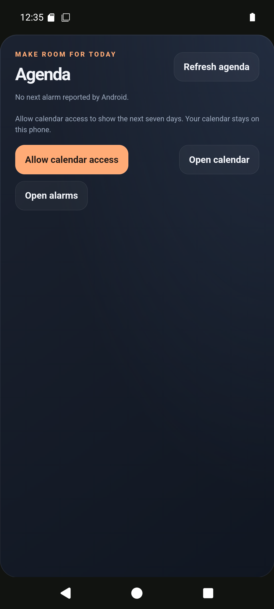

# Android calendar agenda and next alarm

What have you got on today, and when is that damn alarm going off? Agenda shows upcoming calendar entries and the next alarm Android reports. Tap through to the system calendar or alarm app to change either.

Install the [signed Dikciz APK](https://github.com/psyb0t/dikciz-launcher/releases/latest), complete [first-run setup](user-guide.md#install-dikciz-and-make-it-your-home-screen), then open **Dikciz > Dikciz apps > Agenda and alarms**.

- Grant Calendar access, then tap **Refresh agenda**. The agenda reads the events Android exposes to Dikciz.
- Use **Open calendar** to create or edit an event in the Android calendar app.
- Use **Open alarms** to set, edit or confirm alarms in the Android clock app. An empty next-alarm field means Android did not report a next alarm to Dikciz.

The [Agenda and alarms source](https://github.com/psyb0t/dikciz-launcher/tree/main/app/src/dikciz/assets/apps/agenda/) is an editable example of reading device data and delegating edits to system apps.
