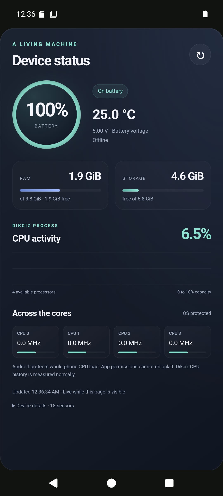

# Android battery, CPU and memory dashboard

Device status puts battery, storage, memory and CPU measurements on one screen. Use it to see how much space is free or to follow Dikciz's CPU use while working in the launcher.

Install the [signed Dikciz APK](https://github.com/psyb0t/dikciz-launcher/releases/latest), complete [first-run setup](user-guide.md#install-dikciz-and-make-it-your-home-screen), then open **Dikciz > Dikciz apps > Device status**.

Read the gauges and CPU history, then expand **Device details** for the additional values Android exposes. Process CPU is the Dikciz process. System CPU and per-core data depend on the device and Android restrictions. An unavailable counter is shown as unavailable. The screen pauses polling when hidden.

Open the [Device status source](https://github.com/psyb0t/dikciz-launcher/tree/main/app/src/dikciz/assets/apps/device-status/) to change the dashboard or reuse its data calls in your own app.
