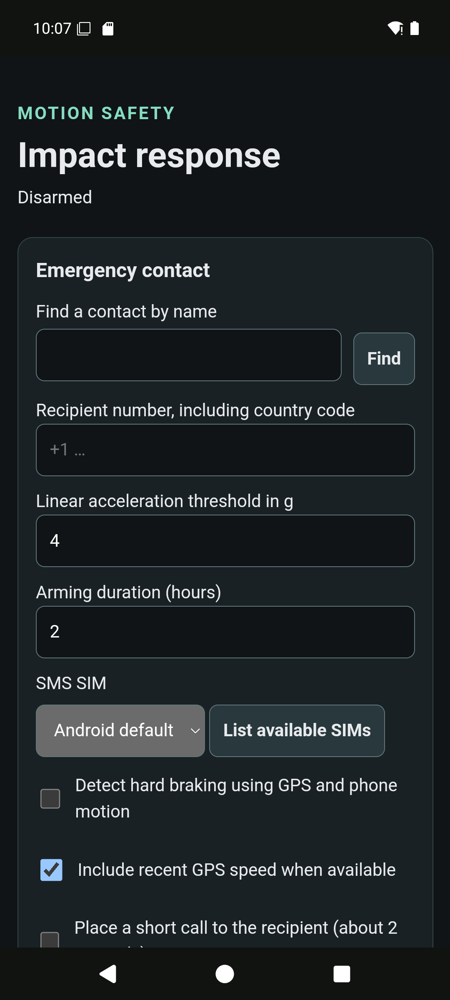

# Impact Response for Android

Arm Impact Response to watch for a hard hit. It measures the phone's linear acceleration. If the emergency countdown expires, it can text the contact you picked. You can also enable hard-braking detection, which uses precise GPS and phone motion.

Impact Response ships inside Dikciz Launcher and opens disarmed. Install the [signed Dikciz APK](https://github.com/psyb0t/dikciz-launcher/releases/latest), follow [first-run setup](user-guide.md#install-dikciz-and-make-it-your-home-screen), then open **Dikciz > Dikciz apps > Impact response**.

<figure>
  
  <figcaption>Fresh setup with monitoring disarmed.</figcaption>
</figure>

## Set up and arm

1. Enter an international phone number with its country code, or find a contact by name and select the exact number. Contact lookup asks for Contacts access.
2. Set an acceleration threshold from 1 to 12 g and a duration from 0.01 to 168 hours. The defaults are 4 g and 2 hours. Decimal hours work, including `2.5` for 2 hours 30 minutes. Set **Emergency countdown (seconds)** to a whole number from 5 to 120. Existing settings default to 20 seconds. Choose an SMS SIM if needed and tap **Save settings**.
3. Open **Review Android access** and enable SMS and notifications, including Dikciz's urgent countdown channel. Keep the app open when arming. A phone without an available linear acceleration sensor cannot arm.
4. Tap **Preview message** to read a sample with invented measurements. Preview sends nothing. Tap **Arm for … hours** to begin, then check for **Live motion sensor confirmed**. Tap **Disarm** to stop.

While armed, the app handles one incident at a time. An impact warning includes the detection time, measured acceleration and threshold. Recent supported GPS readings can add a speed estimate. Android controls the lock screen, audio, and visibility of the warning. Use **Cancel pending alerts** during the countdown to prevent this alert's outgoing actions. Motion and optional GPS monitoring resume for the time left on the original arming duration, so another incident can trigger a new countdown. After the countdown, **Close alert and stop repeats** stops pending steps. Android cannot recall SMS, calls or shares already submitted.

## Optional actions

| Setting | What it needs and does |
| --- | --- |
| Recent GPS speed or hard braking | Precise Android location and timely GPS fixes. Hard braking also needs corroborating phone motion. When speed cannot be established, the message says it is unavailable. |
| Short call | Android phone access, cross-app accessibility and a compatible, visible dialer. The app attempts to end the call after about two seconds and reports if hang-up could not be verified. |
| Save front and rear photos | Camera access and an available camera. Successful captures include the saved file path. Android can restrict camera capture while locked or in the background. |
| Send photos via WhatsApp | Enable photos and enter the exact WhatsApp chat title and the device storage label shown in the Android file picker. The phone must be awake and unlocked, with cross-app accessibility enabled. SMS is submitted first. WhatsApp layout changes or ambiguous matches can stop the share. |

Check **Latest incident** for action outcomes and **Refresh SMS status** for Android's SMS result. A submitted message does not prove the contact received it. Impact Response measures motion of the phone. It can miss real impacts or trigger from ordinary motion, and it cannot confirm a crash or guarantee delivery.

## Read or edit the detector

The [complete app source](https://github.com/psyb0t/dikciz-launcher/tree/main/app/src/dikciz/assets/apps/impact-response/) is an editable custom app. Its backend requests 5 ms sampling, a two-second raw history and batches about every 100 ms. Android determines the delivered rate. The app evaluates samples, stops or renews the capture lease, and disarms when readings are lost or capture ends unexpectedly. Fast background capture can use extra battery. GPS is requested only during active motion monitoring with **Recent GPS speed** or **Hard braking** enabled. Disarming, detecting an impact or losing the motion stream releases that GPS request. See [raw sensor sessions](native-device-control.md#raw-sensor-sessions) and [app source and state](custom-apps.md#files-and-state).

Dikciz upgrades recognized earlier bundled versions while preserving settings, recordings and edited UI files. The countdown field is added to the original bundled UI. Edited backends or manifests keep their contents. Removing the app prevents automatic reinstallation.
