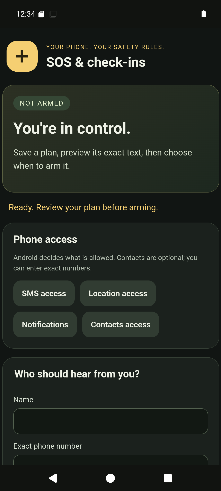

# SOS and safety check-ins for Android

SOS and check-ins can text selected contacts after an explicit SOS trigger or a missed check-in. A countdown gives you time to cancel before delivery. Saved plans stay inactive until you arm them.

Install the [signed Dikciz APK](https://github.com/psyb0t/dikciz-launcher/releases/latest), complete [first-run setup](user-guide.md#install-dikciz-and-make-it-your-home-screen), then open **Dikciz > Dikciz apps > SOS and check-ins**.

1. Add exact contact numbers and save a plan. Preview the message and verify the recipients.
2. Review Android SMS and notification access. Grant location access if you want the plan to include your location.
3. Arm a check-in, or explicitly trigger an SOS. Read the countdown and use its cancel button to stop pending sends.
4. Inspect SMS outcomes in the app. Android access, device state and network coverage affect delivery.

See the [SOS setup and cancellation walkthrough](safety-and-journeys.md#on-the-phone) for plan options and outcome details. [Impact Response](app-impact-response.md) is the separate app for motion-based warnings. The [SOS app source](https://github.com/psyb0t/dikciz-launcher/tree/main/app/src/dikciz/assets/apps/sos/) is editable.
