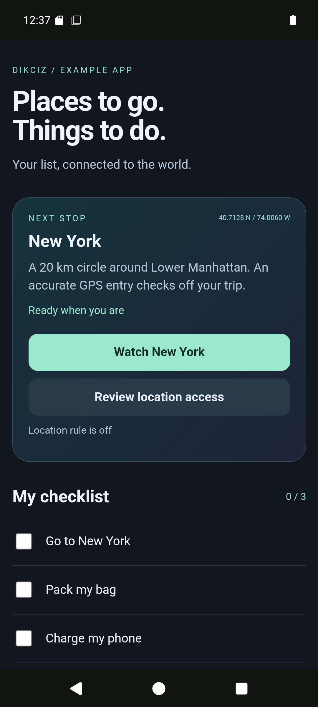

# GPS to-do list for Android

Put **Go to New York** on your list and let the phone cross it off when you get there. That's the bundled arrival rule. For groceries and the rest of the boring stuff, tick the box yourself.

Install the [signed Dikciz APK](https://github.com/psyb0t/dikciz-launcher/releases/latest), complete [first-run setup](user-guide.md#install-dikciz-and-make-it-your-home-screen), then open **Dikciz > Dikciz apps > Travel todo**.

1. Add a task or tick an existing one. The checklist works without location access.
2. To try arrival automation, grant the requested location access and tap **Watch New York**. The arrival rule can run while the app screen is closed, subject to Android's location rules.
3. Stop the watch from the app when finished. Change the destination or send a custom event from the [full tutorial](todo-app-tutorial.md).

The [Travel todo bundle](https://github.com/psyb0t/dikciz-launcher/tree/main/app/src/dikciz/assets/apps/travel-todo/) shows how a geofence event or a custom event can update persistent app state.
