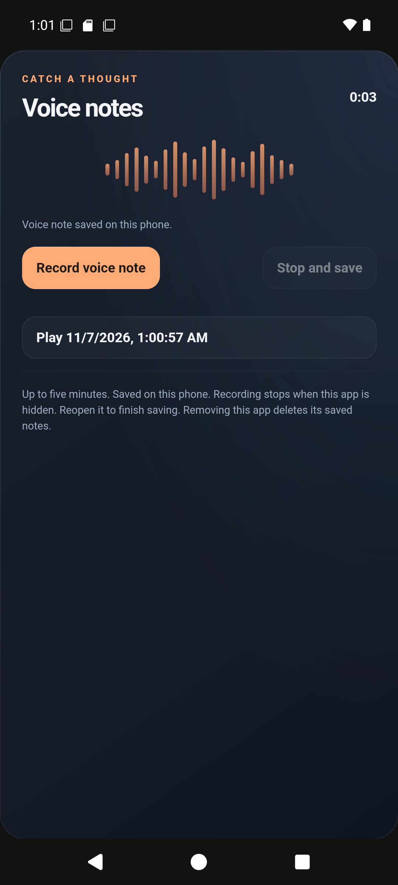

# Local voice notes for Android

Got an idea you'll forget by the time you've typed it? Hit record. Voice notes keeps the audio in the app's local files so you can play it back later.

Install the [signed Dikciz APK](https://github.com/psyb0t/dikciz-launcher/releases/latest), complete [first-run setup](user-guide.md#install-dikciz-and-make-it-your-home-screen), then open **Dikciz > Dikciz apps > Voice notes**.

1. Tap **Record voice note** and grant microphone access if Android asks. Tap Record again if the permission request interrupted the first attempt.
2. Tap **Stop and save**. Leaving the app stops recording. Reopen Voice notes to finish a pending save.
3. Use the playback control next to the saved note.

Recordings live in `/sdcard/Dikciz/apps/voice-notes/files/`. A source-only app export excludes audio. Use a [complete backup](backups.md) to retain recordings alongside settings. The [Voice notes source](https://github.com/psyb0t/dikciz-launcher/tree/main/app/src/dikciz/assets/apps/voice-notes/) shows microphone sessions and app-local file handling.
