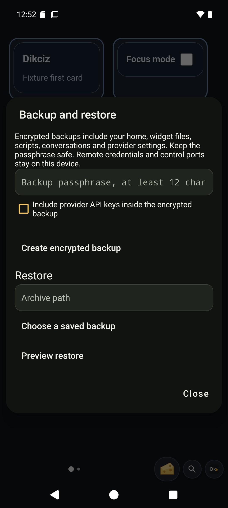

# Encrypted backup and restore

Open **Dikciz settings**, **Backup and restore**. Enter a passphrase of at least 12 characters and create a backup. Archives are stored in /sdcard/Dikciz/backups with the .dikciz-backup extension. Copy an archive somewhere safe with the ordinary file tools.

## What is included

A backup contains home configuration, page and widget documents and state, scripts, reusable HTML templates, themes, fonts, wallpapers, automation configuration, provider profiles and chat transcripts. Provider API keys are omitted unless **Include provider API keys** is selected. Every archive is encrypted, including archives without keys.

Remote passwords, access tokens, control listener settings, logs and operational databases are excluded. A restore preserves the destination device's authentication and listener address/ports. Android permissions and special access are device settings and must be granted separately. Package installations are not backed up.

[Custom apps](custom-apps.md), including SOS plan/run state and app recordings under `apps/`, are also excluded. Their reusable export contains source only. Preserve requested state/data separately and cancel active app work before restoring related home assets.

Limits are 4096 public files, 32 MiB of public file data, 128 provider profiles, 1000 conversations, 10,000 messages and 64 MiB encoded archive size. Large recordings or conversation histories can exceed those bounds. Backups fail explicitly rather than omitting files.

## Preview before replacing data

Select or enter an archive path, enter its passphrase and choose **Preview restore**. Preview checks encryption, file paths, checksums, configuration and chat records before showing counts. It stages plaintext privately, inaccessible through the ordinary file commands. Up to four previews can be staged; each expires after 15 minutes.

Restore replaces the current home and chat history. Scripts and chat event subscriptions remain disabled unless activation is explicitly selected. Restored queued or running turns become interrupted; no old tool call is replayed. Stop active and queued assistant work first. Provider keys omitted from the archive must be entered again.

The restore writes a rollback checkpoint before replacing public files and commits chat changes in one SQLite transaction. On restart, the launcher and background service finish recovery before accepting the home. Other configuration readers stop while the checkpoint exists, preventing starter creation during partial file replacement. Starter identity is included so a restored custom home is preserved on later APK updates. Recovery failure remains an explicit error; it does not load partial configuration.

## Shared commands

| Command | Purpose |
| --- | --- |
| backupCreate | Create an encrypted archive. Requires passphrase; includeApiKeys defaults false. |
| backupsList | List retained archives with pagination. |
| backupPreview | Decrypt and validate path with passphrase. Returns previewId, sha256 and counts. |
| backupRestore | Replace data using previewId, its exact sha256 and confirm=true. activateAutomation defaults false. |

These owner-only operations use the shared HTTP, WebSocket, MCP, HTML and Lua command target. Create, preview and restore are hidden and blocked in read-only assistant mode because they write files or staging data. Listing is read-only. Inspect the installed schemas for exact bounds.

The archive format uses AES-256-GCM with a fresh 16-byte salt and 12-byte nonce, and PBKDF2-HMAC-SHA256 with 600,000 iterations. The passphrase is never saved. Losing it makes the archive unrecoverable.

## On the phone

