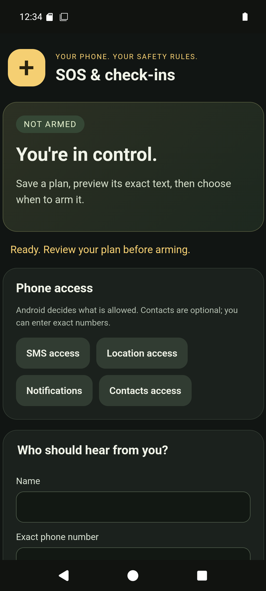
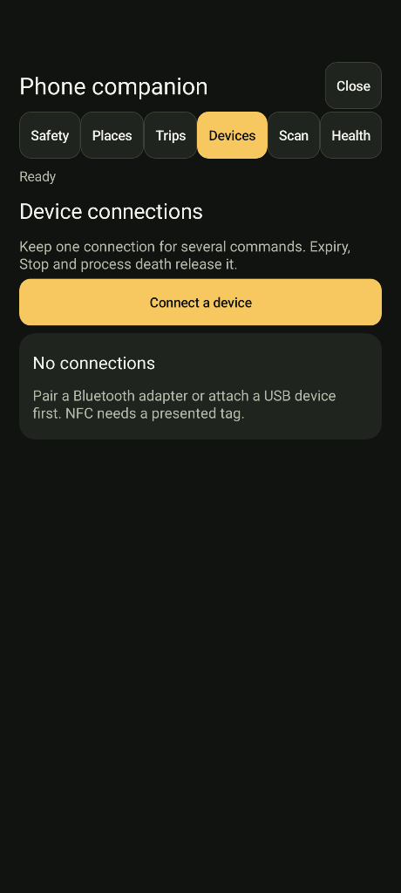
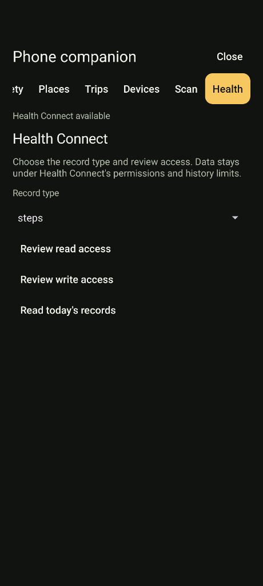
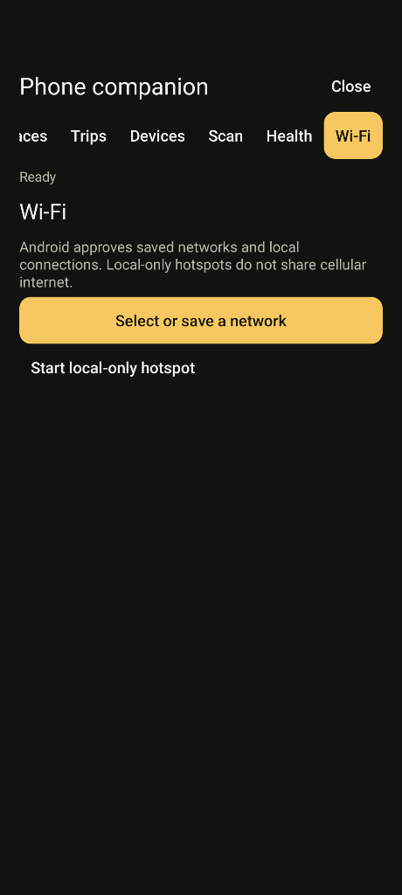

# Safety, journeys and devices

Open **Settings**, **Safety, journeys and devices**. Each tab uses the shared command executor, Android access checks and ordinary response contracts. Launcher controls display the installed version beside Close.

The Safety tab opens the bundled SOS [custom app](custom-apps.md). Its complete UI and backend are editable under `/sdcard/Dikciz/apps/sos/`. **Settings**, **Custom apps** also includes Voice notes, Agenda, Device status and Travel todo, plus creation, complete-source editing and import/export. Places, Trips and the remaining companion tabs keep their native controls.

| Task | Guide |
| --- | --- |
| Choose contacts, preview messages, arm a missed check-in or record a route | [Safety and journeys](safety-and-journeys.md) |
| Keep a Bluetooth, USB or NFC connection across commands | [Device connections and Vehicle console](device-connections.md) |
| Read text/barcodes or create cleaned image PDFs | [Image recognition](image-recognition.md) |
| Inspect grants, read/aggregate records and write owned Health Connect data | [Health records](health-records.md) |
| Suggest/save a network, request a local connection or start a local-only hotspot | [Wi-Fi networks](wifi-networks.md) |
| Run repeatable read-only briefings with a saved provider | [Assistant routines](assistant-routines.md) |
| Stage base/split APKs together or cancel an owned install session | [Package installation](package-installation.md) |

MCP starts at dikciz://docs/guides/companion. Search also indexes the focused manuals and installed tool schemas. Missing hardware, provider access or foreground eligibility remains explicit. Nothing starts sending SMS, recording a route or connecting a peripheral merely because the app was installed.

Companion commands currently require full owner remote authority. Scoped tokens retain their existing finite grants and cannot use these commands to acquire broader access. Assistant read-only enforcement remains independent.

## Native controls

These captures show the isolated emulator, including a fictional safety contact. They demonstrate setup controls, not carrier delivery or physical-peripheral compatibility.
