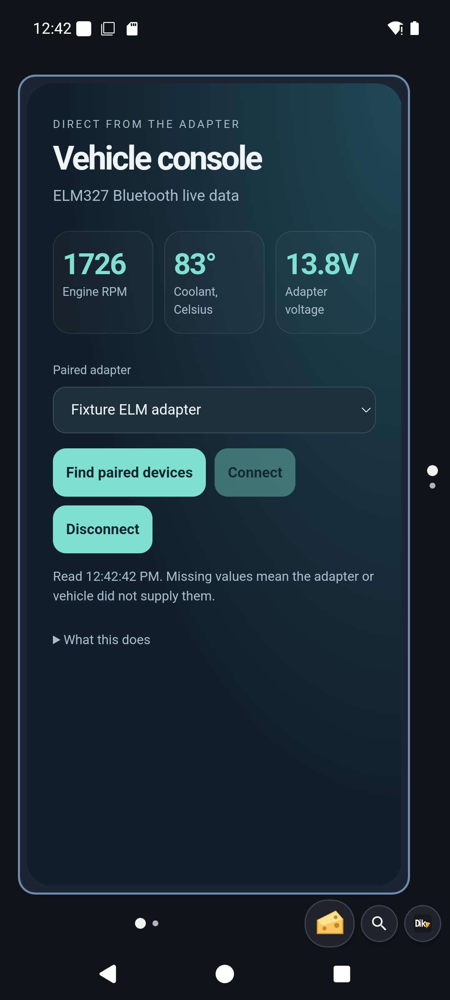

# Persistent device connections

Use `deviceConnectionOpen`, then `deviceConnectionExchange`, `deviceConnectionRead` and `deviceConnectionClose`. `deviceConnectionsList` pages lifecycle metadata. These shared commands work through HTTP, WebSocket, MCP, HTML and Lua. Every transfer counts as mutating for token and assistant access control.

Connections retain hardware across commands. The default lifetime is five minutes, configurable with `maximumDurationMilliseconds` from one second to one hour. At most eight connections can be active. A transfer uses `timeoutMilliseconds` (default 30000, maximum 120000), serializes access and closes on timeout. Reads and writes are bounded to 65536 bytes. Closing, expiry or process death releases hardware; retrying an interrupted write can duplicate peer effects. Completed peer effects are not undone.

## Bluetooth

`kind: rfcomm` requires a paired device `address` and `serviceUuid`; `secure` defaults true. Exchange writes optional base64 bytes and reads up to `readBytes`. Returned chunks do not promise a complete message. Handle framing in the client.

`kind: gatt` requires an address. Exchange actions are `discover`, `read`, `write`, `subscribe`, `unsubscribe` and `notifications`. Use service/characteristic UUIDs and instance IDs when discovery reports duplicates. Notifications have bounded replay cursors and report loss. Bluetooth access and enabled hardware remain necessary.

The optional **Vehicle console** HTML template uses retained RFCOMM to query an owner-selected ELM327-compatible adapter. It reads RPM, coolant temperature and adapter voltage. It handles command framing and displays observation time. It never clears codes or sends vehicle actuation commands. Add it from the HTML template picker; it is not added to the starter home automatically.

## USB and NFC

`kind: usb` requires an attached `deviceId`, optional `interfaceIndex` and owner access. Missing access returns a targeted `usbRequestAccess` recovery. Exchanges support `control`, `bulk` and `interrupt`. Control requires requestType/request/value/index. Bulk and interrupt identify an endpoint on the claimed interface. Supply `readBytes` for input or `dataBase64` for output.

`kind: nfc` requires a foreground unlocked Dikciz activity and a physically presented tag. Choose `technology`, default IsoDep. Supported technologies include NfcA/B/F/V, Ndef and supported Mifare technologies. Exchange supports raw `transceive`, `readNdef` and `writeNdef`. Shared NFC ownership prevents simultaneous one-shot and retained readers. Tag removal is an explicit I/O failure. This does not implement payment decoding or card emulation.

A connected-device foreground notification exposes **Stop all**. Actual profiles, USB endpoints and tag technologies depend on physical hardware. An emulator does not establish real peripheral compatibility.

## Vehicle document

This rendered WebView uses a deterministic mocked ELM adapter response with fragmented reads. It verifies framing, PID conversion, saved state and presentation. It is not a photograph of a connected car or proof of physical adapter compatibility.
