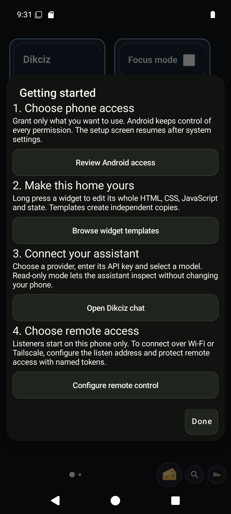
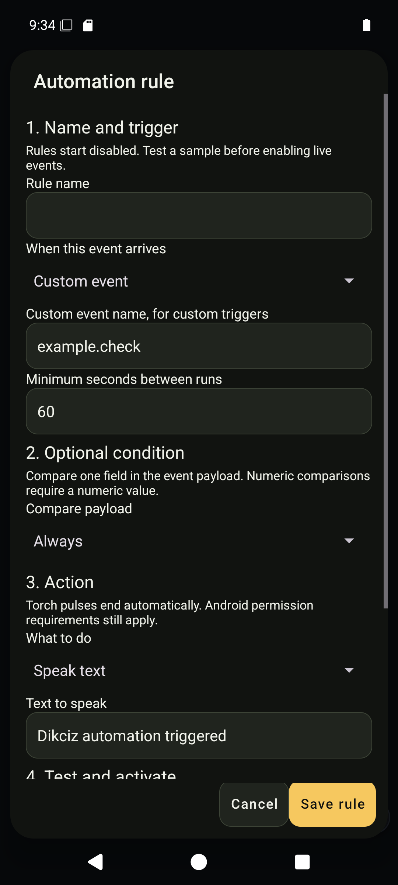
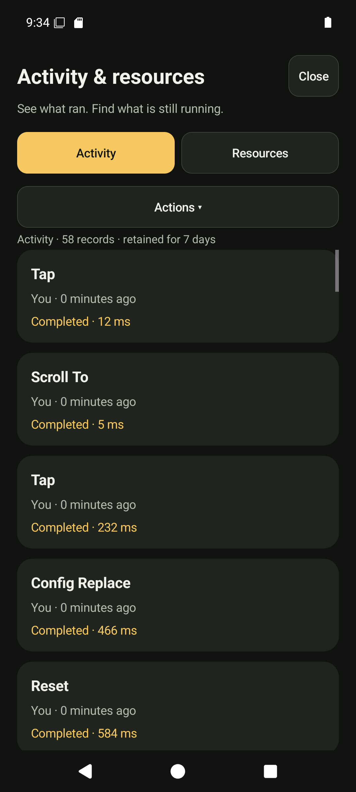

# Activity, resources and automation rules

Open **Dikciz settings**, **Activity & resources** to inspect command outcomes and measured resource use. The activity view shows caller identity, command, request ID, duration and status. It records metadata without command arguments, SMS bodies, screenshots, shell text, provider responses or credentials.

## Activity history

HTTP, WebSocket, MCP and local owner commands share the activity recorder. Local scripts and widgets retain their source identity; assistant tool calls identify the conversation. The activityRead command accepts limit, offset, optional exact actor, optional outcome and mutatingOnly. Outcomes are running, completed, rejected, failed and interrupted. The problem filter combines the last three problem states.

History survives process death, retains up to 10,000 finished records and expires finished records after seven days. Work still marked running when the process restarts becomes interrupted with outcomeKnown=false. A completed command does not imply an external effect was verified. Inspect the operation's own result, such as SMS delivery or activity-launch verification.

The activityCancel command takes activityId from a history row. It requests thread interruption for running work. The Android main thread is never interrupted; main-thread work needs its subsystem stop action. Cancellation is best effort, does not roll back effects and does not prove Android stopped an accepted operation. Read history again and use the subsystem's dedicated stop command where available.

History and administration require owner access. Read-only assistant turns can inspect activity and resources but cannot cancel work or change resource settings.

## Resource measurements

The resourceUsage command returns process CPU, memory/storage measurements, UID network counters, command executor CPU grouped by caller, and configured Lua scripts with their event subscriptions. Counters describe their measurement scope:

- Network counters cover the Android UID since boot.
- Command CPU covers the executor thread and excludes main-thread and WebView JavaScript work.
- Android does not expose reliable per-widget battery drain. The batteryAttributionAvailable field is false.
- The resource page samples only while visible. CPU needs two samples before reporting a percentage.

The resourceControl command takes target and id. A script target disables that Lua script; widget disables the exact HTML wrapper and also requires pageId. A conversation target clears its event rules and requests cancellation. imageStream and speechStream stop capture. The earlier scriptId form remains accepted alone. Configuration reload stops future deliveries; an action already in flight may finish. The resource page offers confirmations for scripts, HTML widgets, conversations and active visual capture.

The resource result reads the current saved home and lists its HTML widget subscriptions, conversations and retained visual captures. Shared-storage access is required to inspect configured resources. It cannot identify which individual JavaScript timer consumed battery. Use the measured process trend, source identity and explicit pause controls to isolate the cause.

## Visual automation rules

Open **Dikciz settings**, **Automation rules**, **Create a rule**. Choose a trigger, optional payload condition, cooldown and speech, vibration or bounded torch action. Test a sample payload before enabling live events. Rules default to disabled.

The editor generates ordinary Lua and an event subscription. The script remains editable in the Lua script manager. Editing generated Lua manually does not rewrite the visual rule definition; saving that visual definition again replaces its generated source.

| Command | MCP tool | Purpose |
| --- | --- | --- |
| automationRulePreview | dikciz_automation_rule_preview | Compile Lua and simulate a sample without invoking Android. |
| automationRuleSave | dikciz_automation_rule_save | Validate and persist a rule, script and subscription. |
| automationRuleDelete | dikciz_automation_rule_delete | Remove one visual rule, script and owned subscription. |
| automationRulesList | dikciz_automation_rules_list | Read saved visual definitions with pagination. |

The installed tool schema documents nested rule fields. Supported triggers are custom events, time, battery, charging, alarms, approximate location and sensors. Other event families remain available through advanced script subscription configuration.

~~~json
{
  "rule": {
    "title": "Battery reminder",
    "event": "battery",
    "enabled": false,
    "minimumIntervalMilliseconds": 60000,
    "conditionOperator": "always",
    "commands": [{"type": "speechSpeak", "text": "Automation reminder"}]
  },
  "sample": {}
}
~~~

Send this to automationRulePreview. It returns simulated=true, generated source and proposed commands. Remove sample when sending the rule to automationRuleSave. Set enabled=true only when live delivery is intended. Android permissions still apply to actual actions.

Rule definitions persist in the automationRules root namespace. Generated scripts, source capabilities and subscriptions use the existing public configuration tree and watcher.

The rule manager reopens saved definitions and confirms deletion. The native form supports one speech, vibration or torch action; the API supports up to eight. Multi-action definitions require the API or Lua editor, preventing silent loss when reopened. Alarm triggers require at least 60 seconds.

The activity page defaults to Actions. All activity includes reads; Problems combines rejected, failed and interrupted work. Refresh pauses while reading scrolled history. Both tabs and confirmation dialogs remain available to semantic UI commands.

Getting started in Settings links the owner to Android access, reusable widget documents, assistant setup and private-network listener configuration. It grants nothing automatically.

The resource screen shows enabled scripts and HTML widgets, active chat work/event rules, live visual capture and the five largest recorded callers. The API retains the full configured inventory for inspection. Disabled resources and inactive conversations remain in their normal managers.

## On the phone

 

