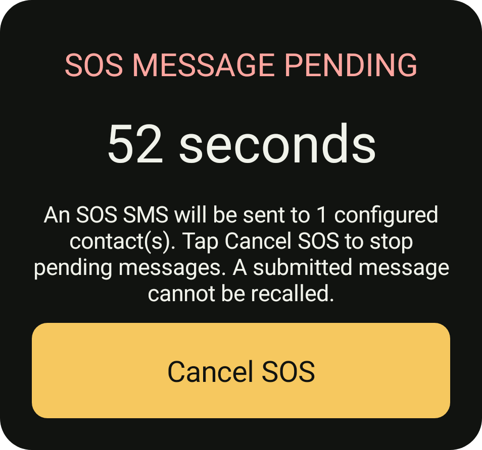

# Safety, places and journeys

Open **Settings**, **Safety, journeys and devices** for native Safety, Places and Trips screens. The same operations are available through HTTP, WebSocket, MCP, HTML and Lua. Discover the installed schemas before sending commands.

## Contact plans and check-ins

Save exact contact addresses with `sosPlanSave`. Each contact has `address` and optional `label`. The native editor can pick a phone contact without modifying it. Saving a plan stays inactive. Preview with `sosPreview`; it does not submit SMS.

`checkInSeconds` defaults to 3600, minimum 60. `graceSeconds` defaults to 60, minimum 5. `updateSeconds` defaults to 600, minimum 60. `maximumUpdates` defaults to 3, range 1..24. Up to ten distinct recipients are allowed. The optional message supports `{location}`, `{accuracyMeters}` and `{timestamp}`; absent or stale fixes remain explicitly unavailable. Optional `subscriptionId` chooses an SMS SIM.

Use `sosControl` with `action: arm` or `trigger` and `confirm: true`. Arming waits for the check-in deadline, then enters a cancellation grace. Triggering begins the grace immediately. `checkIn` resets the check-in deadline. `cancel` prevents future submissions. It cannot recall submitted SMS. Read `sosStatus` for saved plan, run state and receipt keys. Query the existing `smsStatus` command for carrier outcomes; submission is not delivery.

Monitoring requires foreground location, SMS sending and notification access. A visible foreground notification provides **Stop all**. Android can delay inexact alarms, restrict background starts, stop processes or lose service. Rebooted runs become `needs_review` and do not resume outgoing messages automatically. This is an owner automation, not a guaranteed emergency service. Review permissions and test cancellation before relying on a plan.

Each recipient/update has a persisted idempotency key and frozen message before dispatch. Retry after process failure reuses that key. A completed run stops at the configured update limit; rejected submissions need review.

## Audible cancellation warning

During cancellation grace, Dikciz shows a large countdown and **Cancel SOS** button over other apps when Draw over other apps access is granted. Without that access, it shows a dialog while a Dikciz activity is visible and retains an urgent **SOS message pending** notification with its own **Cancel SOS** action. Tapping the notification opens Safety controls. Android controls whether a heads-up or lock-screen notification appears; an overlay cannot bypass the keyguard or system-protected windows.

The warning pulses an alarm tone and vibration and uses an installed offline English TTS voice to explain that SOS messages are pending and how to cancel. For grace periods longer than ten seconds, it speaks another warning near the final ten seconds. The app does not change volume or Do Not Disturb. An absent speech engine or offline voice leaves the visual and tone warning available. Arming requires the separate SOS countdown notification channel to remain urgent.

`sosStatus.warning` reports whether a warning episode is active, the observed presentation, attached unlocked-screen visibility, remaining seconds, requested audio/vibration, alarm volume and speech state. These are execution observations, not proof that a person heard the alert. The same presentation runs for manual triggers, missed check-ins and the grace interval before subsequent configured updates. API/native cancellation stops future sends and warning resources. A message already submitted cannot be recalled. Ordinary geofences and route recording stay quiet and continue when only SOS is cancelled.

The warning card above was captured on the isolated emulator before cancellation.

## Places

`geofenceSave` accepts `title`, latitude, longitude and `radiusMeters` (100..1000000), optional ID, `enabled` (false by default) and `dwellMilliseconds`. Up to 32 fences can be saved. Monitoring uses Android location callbacks, accuracy checks and crossing hysteresis, with a visible location service. It emits `geofence.enter`, `geofence.exit` and optional `geofence.dwell` through the ordinary custom-event bus. Event payloads identify the fence and observed fix. Dwell uses elapsed time. A reboot establishes a fresh observation.

List with `geofencesList` and ordinary offset/limit pagination. Delete one exact ID with `geofenceDelete`. A renamed fence keeps its observation state when its geometry and monitoring settings remain unchanged.

## Recorded journeys

`journeyControl` with `action: start` starts one active route, optionally naming it and choosing `sampleIntervalMilliseconds` (1000..60000, default 10000). `action: stop` requires the journey ID. No location is invented between samples. Distance sums accepted sampled segments and includes GPS uncertainty.

`journeysList` lists saved summaries. `journeyRead` pages ordered points using ID, offset and limit; follow `hasMore`. Each point includes fix time and accuracy. Up to 64 journeys and 10000 points per journey are retained. Reboot interrupts recording. Stop before deleting; `journeyDelete` requires ID and `confirm: true`, and removes owned route points too. The native route preview draws recorded coordinates locally.

Safety plans and routes live in the app's private companion SQLite database. They are not public home configuration and are not currently included in the portable home/chat backup. Clear them explicitly before clearing app data.

A public-home reset does not clear private companion plans/history or recall SMS. Cancel active safety monitoring explicitly before resetting a setup.
