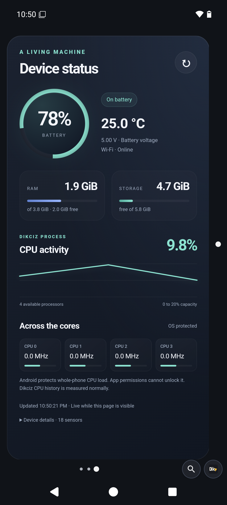

# Starter home

Fresh installations and **Reset Dikciz home** use three pages: Home, Tools and Device. Customized homes survive APK updates; a still-pristine starter may refresh to the bundled layout. Reset replaces pages, restores matching bundled utility scripts and the 8-column, 6-row grid, and preserves unrelated saved scripts and policies.

Every HTML widget owns its complete HTML, CSS, JavaScript, state and files. Long press its content or handle to edit, resize, move, change appearance or delete it. Removing one widget preserves its neighbors and removes its own files beneath `/sdcard/Dikciz/pages/<page-id>/widgets/<widget-id>/`. Library templates create independent copies.

## Home

**Time and weather** occupies two rows. It shows local time, date, city and temperature. Expand **Weather details and city** for feels-like temperature, wind, rain probability, low/high, European AQI and city controls. It tries already-permitted phone location when no city is saved. Missing access stays inline until you tap **Use my location**. Grant access, then tap again. A manual city takes precedence. Device locations are checked again after five minutes while visible.

City search sends the name to Open-Meteo; weather and air-quality requests send coordinates. The services load independently, retain dated successful readings on failure and refresh missing or fifteen-minute-old readings when opened. Requests time out after fifteen seconds and accept at most 64 KiB each. There is no hidden-page polling. Calendar, recordings and device metrics are not sent.

Attribution: [Open-Meteo weather](https://open-meteo.com/en/docs), [geocoding](https://open-meteo.com/en/docs/geocoding-api), and [CAMS ENSEMBLE air quality through Open-Meteo](https://open-meteo.com/en/docs/air-quality-api). Public endpoints are for personal, non-commercial use under the provider terms.

**Most used apps** occupies three rows and shows up to eight installed apps with Android icons. Optional Android Usage access lets it rank foreground time over seven days. Without access or recent history, it shows **Your apps**. Tap **Use app history**, allow access in Android and return. Usage ranking refreshes once a minute while visible and immediately on return to the widget. The document subscribes to Android package changes and removes an uninstalled app immediately, including during an in-flight icon request. Updated complete template copies establish their own packageChanged subscription without replacing other subscriptions. App icons use the same checked launch action as other entrypoints.

The final row contains native Phone, Camera and Android Settings shortcuts, then Obtainium, F-Droid or Play Store in that preference order. Dikciz resolves installed launchable activities and their real icons. Missing handlers leave their slot empty. These are ordinary movable and editable shortcuts on Home. Hold a native app or group still for one second, then drag to move it. Releasing after the hold opens its edit controls. Moving before that deadline cancels the hold and cannot group icons.

**Flash attack** requests eight brief torch pulses. Tap again to stop. Each on request has a native 250-millisecond off timer independent of JavaScript; leaving the page also requests off. Camera access is requested only after a tap. Missing flash hardware produces an explicit error. **Dikciz time** speaks its demonstration line through Android text-to-speech at the current speaker volume. Neither action starts automatically. Speech is not a cellular call.

## Tools

**Agenda** occupies three rows. It shows the next Android alarm and up to three upcoming calendar occurrences in the current seven-day window. Android expands recurring events. All-day dates retain their calendar date. Calendar data stays on the phone. Tap **Allow calendar access**, return from Android and tap **Refresh agenda**. The document refreshes once a minute while visible and when reopened. Its bounded preview scans up to ten pages of fifty occurrences and directs you to Calendar when more remain. **Open calendar** and **Open alarms** request Android activities. Missing handlers produce an explicit error. The widget never changes events or alarms.

**Voice notes** occupies three rows. Recording starts only when you tap **Record voice note**. If access is missing, review it and tap Record again. Tap **Stop and save** to finalize an AAC M4A. Recording has a five-minute maximum and stops when the page becomes hidden. This is foreground microphone capture. Android interruptions report failure rather than claiming a saved recording.

Completed audio moves into this widget's directory with generated filenames. The five most recent recordings have playback buttons; earlier files and metadata remain. **Stop playback** releases playback. A failed move or metadata save leaves **Retry saving** available. Saved notes survive reopening; removing the widget deletes them. Copy recordings elsewhere before removing the widget to keep them. Active recorder sessions do not survive process death.

## Device

**Device status** fills its page with a battery ring, temperature and voltage, network state, RAM/storage meters, bounded CPU history and individual core tiles. It refreshes every five seconds while visible or when you tap refresh. Storage describes the filesystem holding Dikciz app data. Network presence does not guarantee working internet. It starts no sensor listeners and requests no root access.

The chart measures this Dikciz process as a percentage of available processor capacity. It excludes other apps and separate WebView renderer processes. Android can protect whole-phone CPU counters and clock files; a runtime permission cannot unlock them. Protected values stay unknown. Where exposed, core tiles show measured utilization or a clock frequency labeled in MHz or GHz. Clock speed is not a guessed utilization percentage.

## Optional complete templates

Previously placed documents and existing public library packages keep their saved source during APK updates. Reset the bundled home or update a document with the new package source to adopt widget-script fixes.

The picker includes all five starter documents with fresh independent state. The combined **Home dashboard**, app search, notes, detailed **System dashboard**, **Live sensors**, and **BTC and economic news** remain optional. Adding a template copies its entire document. **Save to library** makes a customized document reusable. Library edits never silently change placed widgets. Reduced-motion settings and visibility control optional visual effects.

The sensor template samples real hardware while visible. Markets and news fetch on explicit Refresh, retain dated successful data and report provider failures. See [HTML editing](user-guide.md#edit-an-html-widget), [configuration](dikciz-configuration.md) and [API coverage](capability-coverage.md).

## Optional Lua utilities

Three examples start disabled. Review them in **Settings**, **Scripts** before enabling them. Policies and subscriptions are prepared; none depends on a particular page or widget.

| Script | Behavior |
| --- | --- |
| `low-battery` | One notification at 20 percent or lower while discharging. Charging or reaching 30 percent resets it. |
| `charge-ready` | One notification at 80 percent or higher while charging. Unplugging or dropping below 75 percent resets it. |
| `screen-lock` | Explicit manual lock with owner-enabled Device Administration. Granting access never triggers it. |

Notification reminders need Android notification permission. Add a native script dashboard from the picker when wanted. See [Lua scripting](scripting-tutorial.md).
