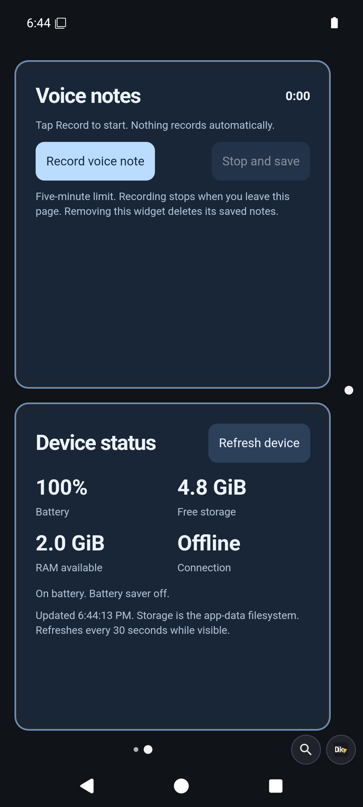

# Starter home

New installations start with two pages. Existing edited homes keep their pages, widgets and scripts when the APK updates. **Reset Dikciz home** replaces saved pages with this starter and restores matching bundled scripts. Other saved scripts and policies remain; disable or delete unwanted older examples under Settings, Scripts.

## Home

- **Clock and search** shows local time and date. Search opens the browser only after submitting a query.
- **Find an app** filters the real installed-app catalogue by name or package and launches a selected result. Up to six matches appear. Open the bottom app drawer to see all apps and add native shortcuts.
- **Quick note** saves up to 2,000 characters on this phone when you tap **Save note**. Unsaved edits are marked. Saved text survives switching pages and reopening Dikciz.

Home is one full-page HTML widget containing three saved cards in one WebView. Long press a card for **Edit**, **Delete**, or **Save as preset**. Deleting a card keeps its containing document and siblings. Use the top move handle for whole-document controls, **Add preset or block**, or the full HTML/CSS/JavaScript editor. Nothing requires a bundled background script.

The clock, app search and note are also ready-made presets. Add them inside another HTML widget through **Add preset or block**, or create separate native grid widgets through the HTML widget library. The **Home dashboard** library preset recreates the combined document. Repeated notes keep independent instance IDs and state files under their page and WebView wrapper. Deleting one removes only its state and custom files. Custom card presets copy source and behavior, never saved note text or other state. Existing homes keep their layout on update; reset the home or add the dashboard preset to use the combined starter.

## Insights

**Your phone** reads Android battery level, plugged-in state, battery saver, network transport and internet validation. It refreshes when the page opens or when you tap **Refresh phone**. Android reporting an active network does not always mean internet access works.

**Weather and air** starts with no city and no network request. Enter a city, tap **Find city**, then choose the correct match. A city search is sent to Open-Meteo geocoding; selecting or refreshing sends the selected coordinates to its weather and air-quality APIs. The widget does not request GPS, discover your location or send contacts, notes or other phone data.

It displays temperature, feels-like temperature, wind in km/h, today's rain probability, low/high temperatures and European AQI. Weather and air quality load independently. Missing values appear as unavailable. Saved readings carry their fetch times and remain labeled as saved data until you explicitly refresh. There is no background polling, including after restarting or changing pages.

Requests time out after 15 seconds and each response is limited to 64 KiB. A failed city search leaves the selected city unchanged. Choosing another city clears the previous city's readings. Partial service failure retains available readings for the selected city and names the failed service. No matching city, offline service and malformed responses stay recoverable through Find city or Refresh weather.

Data attribution: [Open-Meteo weather](https://open-meteo.com/en/docs), [Open-Meteo geocoding](https://open-meteo.com/en/docs/geocoding-api), and [CAMS ENSEMBLE air-quality data through Open-Meteo](https://open-meteo.com/en/docs/air-quality-api). The public endpoints are for personal, non-commercial use under the provider's terms. A commercial deployment must arrange appropriate service access.

## Optional Lua utilities

Open **Settings**, **Scripts** to inspect a script before enabling it. A script dashboard can also be added from the widget picker.

| Script | Behavior |
| --- | --- |
| `low-battery` | One notification at 20 percent or lower while discharging. Charging or reaching 30 percent resets it. |
| `charge-ready` | One notification at 80 percent or higher while charging. Unplugging or dropping below 75 percent resets it. |
| `screen-lock` | Explicit manual lock only, with owner-enabled Device Administration. Granting access never triggers it. |

All Lua source records start disabled. Policies and subscriptions are prepared so enabling a source activates its utility without editing JSON. Notification reminders need Android notification-posting permission. The utilities save their reminder state, suppress repeated alerts, and do not depend on page or widget addresses.

See [configuration](dikciz-configuration.md), [Lua scripting](scripting-tutorial.md) and [HTML widgets](user-guide.md#edit-an-html-widget) to customize them.
