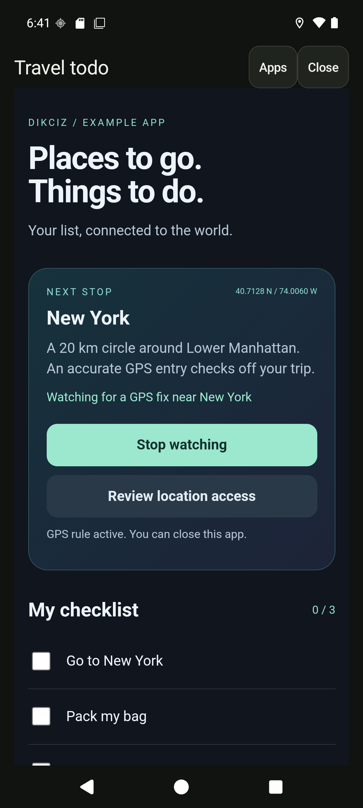
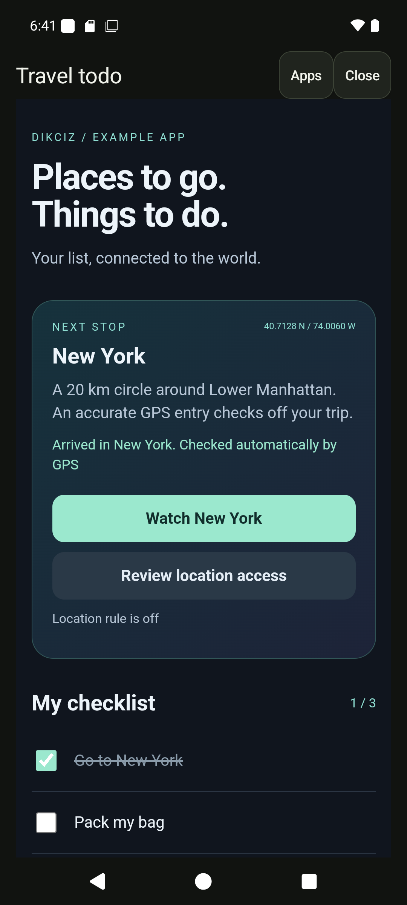
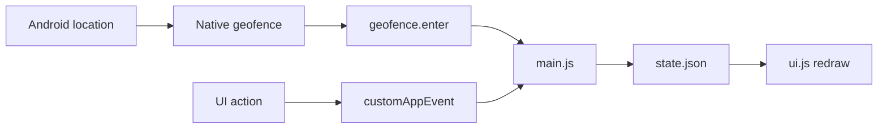
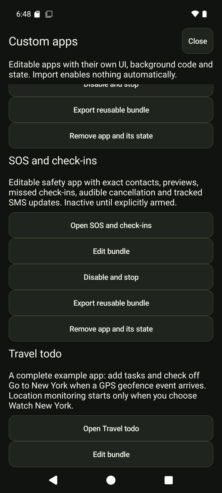
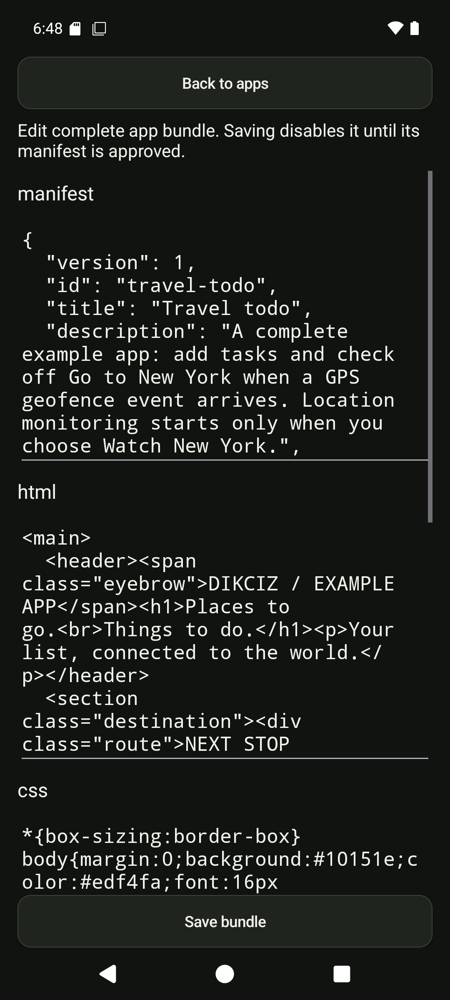
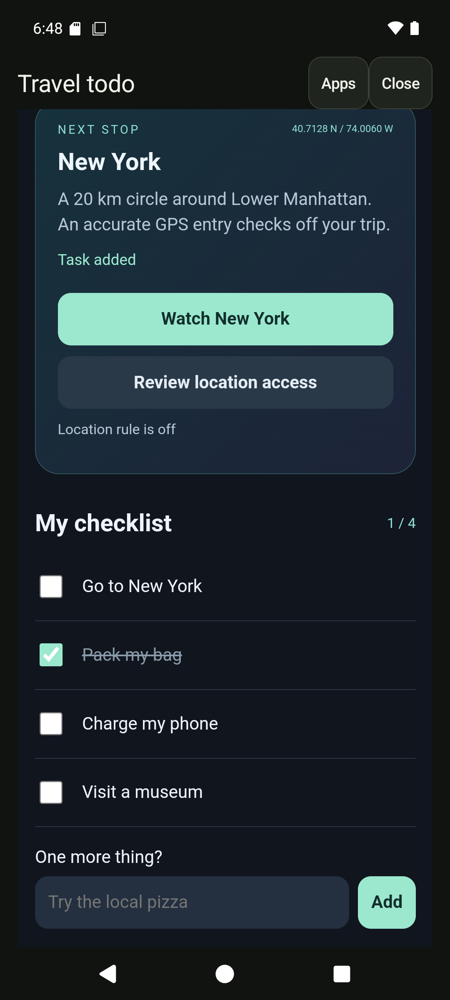

# Build a todo app that reacts to GPS

Build one complete Dikciz app with a checklist, a JavaScript backend and saved state. Its **Go to New York** item checks itself when an accurate location fix enters an example destination circle. The backend keeps listening after you close its interface.

The working reference ships as **Settings > Custom apps > Travel todo**. Its [five source files](../app/src/dikciz/assets/apps/travel-todo/) are also in this repository. It starts with location monitoring off. No API key, model, messages or calendar writes are involved.

<p> </p>

The captures come from the current development build on a private Android emulator. Its location was moved from London to New York through the emulator location fixture. The real Android location callback, native geofence, shared event bus, app backend and persisted state handled the change. This is not a physical trip or a synthetic geofence event.



## 1. Open the reference

Open **Settings > Custom apps > Travel todo**. Check a task manually or scroll down to add your own. The initial list has **Go to New York**, **Pack my bag** and **Charge my phone**. You can use the list with location access denied.

To inspect the source, choose **Apps**, then **Edit bundle** beside Travel todo. The editor exposes the manifest, HTML, CSS, UI JavaScript and backend source together. Stop an active location watch before editing. Saving disables the app; return to the manager, review its commands and choose **Enable app**.

<p> </p>



## 2. Understand the five files

| Source | Job |
| --- | --- |
| [app.json](../app/src/dikciz/assets/apps/travel-todo/app.json) | Identity, command declarations and event subscriptions. |
| [ui.html](../app/src/dikciz/assets/apps/travel-todo/ui.html) | Checklist, destination card, task input and explicit location controls. |
| [ui.css](../app/src/dikciz/assets/apps/travel-todo/ui.css) | The complete document's layout and appearance. |
| [ui.js](../app/src/dikciz/assets/apps/travel-todo/ui.js) | DOM listeners, bridge requests and redraws when state changes. |
| [main.js](../app/src/dikciz/assets/apps/travel-todo/main.js) | Headless task operations, geofence setup, event matching and cleanup. |

Dikciz installs editable copies at `/sdcard/Dikciz/apps/travel-todo/`. It writes `state.json` there and reserves `files/` for app-owned data. App state is independent of home pages and widgets. Globals reset for each backend call, so keep durable values in state.

The manifest subscribes to two inputs:

```json
{
  "version": 1,
  "id": "travel-todo",
  "title": "Travel todo",
  "description": "A checklist that reacts to GPS and custom events.",
  "language": "javascript",
  "commands": ["geofenceSave", "geofenceDelete", "requestDeviceAccess"],
  "events": ["geofence.enter", "example.todo.complete"]
}
```

It declares only `geofenceSave`, `geofenceDelete` and `requestDeviceAccess`. App-local state/event commands are supplied by the host. Neither the manifest nor enabling the app grants Android location access.

## 3. Send UI actions to the backend

The UI calls the shared bridge after `dikciz-ready`. For example:

```javascript
const reply = await dikciz.command("customAppEvent", {
    event: "todo.add",
    payload: {title: "Try the local pizza"}
});
const state = reply.state;
```

The host fills in the calling app ID and rejects access to another app. `onEvent(event)` in `main.js` receives the event and a read-only `context.state`. It copies that state, changes the list and returns a `patchState` action. The host validates and saves it, then the visible UI receives `dikciz-state` and redraws. The UI uses DOM creation and `textContent`, so task titles remain text.

This is the shared result shape:

```javascript
return {
    status: state.lastAction,
    result: {watching: state.watching},
    actions: [{type: "patchState", values: state}]
};
```

The example accepts up to 20 tasks with titles of 1 to 120 characters. Errors return a code and message; a rejected add leaves the typed title available to correct.

## 4. Set up the GPS rule

Choose **Review location access**, grant precise foreground location in Android and enable the device's location setting. Allow Dikciz notifications in Android so background monitoring has a visible notification. Return to the app and press **Watch New York**. Starting the rule is an explicit action, separate from opening or enabling the app.

The backend calls `geofenceSave` with these values:

```json
{
  "id": "travel-todo-nyc",
  "title": "Travel todo: New York",
  "latitude": 40.7128,
  "longitude": -74.0060,
  "radiusMeters": 20000,
  "enabled": true
}
```

The 20 km circle around Lower Manhattan is an example destination, not the legal boundary of New York City. Change the coordinates and radius in `NEW_YORK` inside `main.js` for another destination. The fence ID derives from `context.scriptId`, so independent copies use independent fences.

Android supplies location callbacks to the native geofence host. Dikciz rejects stale or inaccurate fixes and uses crossing hysteresis. A fresh inside fix, including the first accepted fix when you are already inside, produces `geofence.enter` with `payload.id`, `payload.title` and `payload.location`.

The backend ignores unrelated fence IDs and inactive watches. On a match, it deletes its fence, sets the `new-york` task's `done` value to `true` and saves the list. Other tasks stay unchanged. Repeated events do not rearm the watch. Close the app, arrive, then reopen it to see the persisted result. Android can delay callbacks or stop background work; this is an automation example, not guaranteed arrival detection.

## 5. Trigger another task with a custom event

The same app listens for `example.todo.complete`. Its payload identifies one saved task, such as `{"id":"pack"}`. A broadcast reaches every enabled copy subscribed to that name. Use a different event name in each manifest and backend when copies should react independently. An ordinary HTML widget can publish it with:

```javascript
await dikciz.emitEvent("example.todo.complete", {id: "pack"});
```

HTTP, WebSocket and MCP publish through `automationDispatch`, or MCP `dikciz_automation_dispatch`. Read the current configuration and substitute an actual HTML widget address for `YOUR_HTML_WIDGET_ADDRESS`:

```json
{
  "sourceWidgetAddress": "YOUR_HTML_WIDGET_ADDRESS",
  "actions": [{
    "type": "emitEvent",
    "event": "example.todo.complete",
    "payload": {"id": "pack"}
  }]
}
```

A publish acknowledgement confirms publication. Read `customAppRead` for app `travel-todo` and check `state.tasks` for completion. This custom event exercises the same background subscription path. Owner-published events are automation inputs, not proof of a physical trip. Do not fabricate a `geofence.enter` event and call that a GPS test.

For an app-specific request without publishing, use `customAppEvent` with `appId: "travel-todo"`, `event: "todo.toggle"` and `payload: {"id":"pack"}`. The accepted backend events are `todo.open`, `todo.add`, `todo.toggle`, `todo.watch`, `todo.stop`, `geofence.enter`, `example.todo.complete` and the host lifecycle events.

## 6. Copy, stop and extend it

Press **Stop watching** to delete this app's fence. Arrival stops it automatically. Disabling or removing the app invokes its `app.stopped` backend cleanup; that also deletes its own fence while leaving unrelated fences alone. Stop monitoring before editing or replacing its source. Native geofences are separate persisted records, so inspect **Safety, journeys and devices > Places** if you edited away the cleanup code.

Choose **Export reusable bundle** to share the five source files. Exports exclude private state and recordings. To make an independent copy, install the source with a new `app.json` ID, then explicitly enable it. The new ID gets separate state and an independent fence. Existing bundled copies preserve user edits during APK updates; a home reset does not restore edited app source. Current encrypted home/chat backups exclude custom apps.

To use Lua for background logic, change the manifest language to `lua`, provide `main.lua` with `on_event(event)` and keep the same interface files. For standalone background scripts without an app UI, read [background JavaScript](background-javascript.md) and the [Lua/event tutorial](scripting-tutorial.md). The [custom-app guide](custom-apps.md) owns host permissions, timers, alerts, archives and recovery.

## Verify the example in development

From the repository root, use the pinned Android Lab image through Make:

```bash
make build
make dikciz-test-existing-apk DIKCIZ_TEST_SELECTOR=test_travel_todo
make dikciz-test-stop
```

The focused cases exercise all three transports, invalid tasks, custom-event delivery, real emulator GPS with the UI closed, saved state and geofence cleanup. Captures remain under `.android-lab/shared/artifacts/travel-todo-guide/`. The test uses the private emulator, not a connected physical phone.
