# Dikciz user guide

This guide starts after you have downloaded and installed a Dikciz APK on your Android phone. It covers using the launcher on the phone. Each screenshot follows the step beside it.

For events, HTML widgets, Lua scripts, and typed actions, start with the [scripting tutorial](scripting-tutorial.md). Read [Dikciz configuration](dikciz-configuration.md) for the editable-file layout and [automation control](automation-control.md) for WebSocket, MCP, and remote-control commands.

Tap the cheese beside the launcher controls to open the [on-device assistant](embedded-chat.md). Configure its provider in chat Settings, create conversations, expand the panel or hide it while the agent works.

## Install Dikciz and make it your home screen

1. Open the Dikciz APK from your browser, file manager, or Downloads app.
2. If Android asks, allow that app to install unknown apps, then accept Android's installation screen.
3. Open Dikciz. If Android asks which Home app to use, choose **Dikciz** and make it the default. If it does not ask, press the Home button and choose Dikciz there.
4. On a cold start, Dikciz shows its mark and five joke lines for five seconds. The bottom of this screen shows the running version and build type, such as release or debug. Tap anywhere to skip it.
5. The first Dikciz screen asks for shared-storage access. Tap **Grant file access**, enable access for Dikciz in the Android panel, then return to Dikciz.

That access lets Dikciz create and watch `/sdcard/Dikciz/`. It contains your pages, widgets, themes, scripts, packages, and logs. Dikciz cannot load or save your home until Android grants it.

The bundled home opens on `Home (1H1V)`. Its native bottom and right rails show the current horizontal and vertical page coordinates. Every page is a fixed grid. A full page rejects another native widget instead of making items overlap or extending the page below the screen.

If release and debug builds are installed together, Android lists them as **Dikciz** and **Dikciz (debug)**. Choose **Dikciz** as Home when using Obtainium releases. Updates replace only the matching package; updating release does not replace or restart the debug app.

After an APK update, Dikciz reopens automatically when it is the default Home app or has overlay access. If it stays closed, tap **Dikciz updated** in notifications or open the app. [Update recovery](remote-device-control.md#recover-after-an-apk-update) explains the required access and reconnecting remote clients.

## Move around the home

Apps opened from the drawer or a native shortcut run in their own Android task. Press Home to return to Dikciz, then use Android Recent apps to resume the app.

### Switch pages or search by name

Swipe across a page or tap a rail dot to move one page. Tap the magnifier beside the horizontal rail to search all pages. Search matches the page name and its stable address. The bundled pages are `Home (1H1V)`, `Tools (2H1V)`, `Device (3H1V)` and `Goblin (4H1V)`. Home combines time/weather, frequently used app icons and a native bottom row of Phone, Camera, Settings and an installed store. Tools has agenda and voice notes. Device has a battery ring, resource bars, CPU history and core tiles. Goblin has manual speech, alien sounds, torch pulses and outdoor weather checks, with optional Lua automations that start disabled. Each WebView owns its complete source and state. Weather uses permitted location or a chosen city; calendar and microphone access are requested from their widgets. Read the [starter home guide](starter-home.md) for details.

### Create, name, reorder, or lock a page

Long press a rail beyond its last dot to create a page at that edge. Long press before its first dot to create one on the other edge. Dikciz selects and saves the new page immediately.

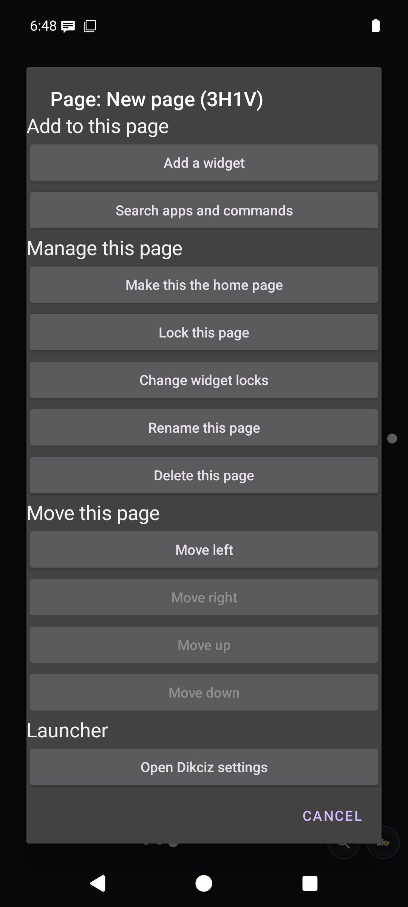

Tap the Dikciz mark beside the horizontal rail, choose **Manage this page**, then choose **Rename this page**. Use a name that tells you what belongs on the page. Scripts and configuration use the stable address, such as `2H3V`.

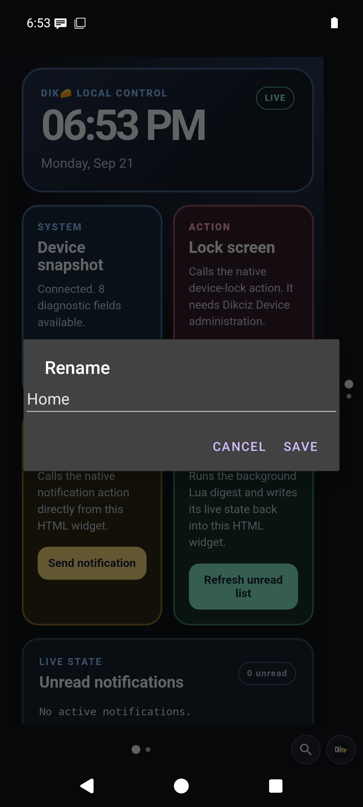

Open page search, type the name, then tap the matching row to return to it.

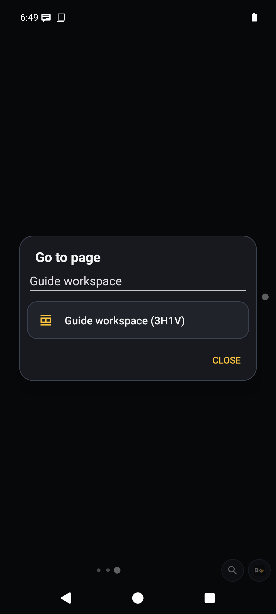

**Manage this page** also lets you do the following:

- **Make this the home page** chooses the page Dikciz opens when Android returns Home.
- **Lock this page** prevents accidental layout edits until you unlock it. Widget buttons and normal page navigation still work.
- **Move left**, **Move right**, **Move up**, and **Move down** exchange the page with its neighbour. A direction with no neighbour is disabled.
- **Delete this page** removes the current page after confirmation. Create pages from the rail edges.

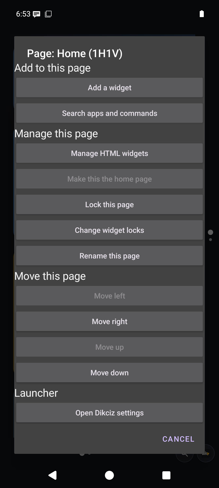

### Set the grid to fit your layout

New and reset homes start with 8 columns and 6 rows. Open **Settings**, then change grid columns, rows, gap, or outer padding. Dikciz shrinks widget rectangles to fit and relocates collisions into free cells. Full-width HTML follows the column count. Items that cannot fit are removed from their pages in saved order, and Settings reports the number removed. Removing a shortcut leaves its app installed. Removing a widget also removes its scoped state. The right and bottom pager rails provide their own outer spacing, so grid padding is not added twice beside them. Widget appearance margins still apply.

## Add apps and widgets

### Find, launch, or manage an installed app

Tap the Dikciz mark and choose **Open app drawer**. You can also swipe up from the horizontal page rail. The drawer lists launchable apps installed on your phone.

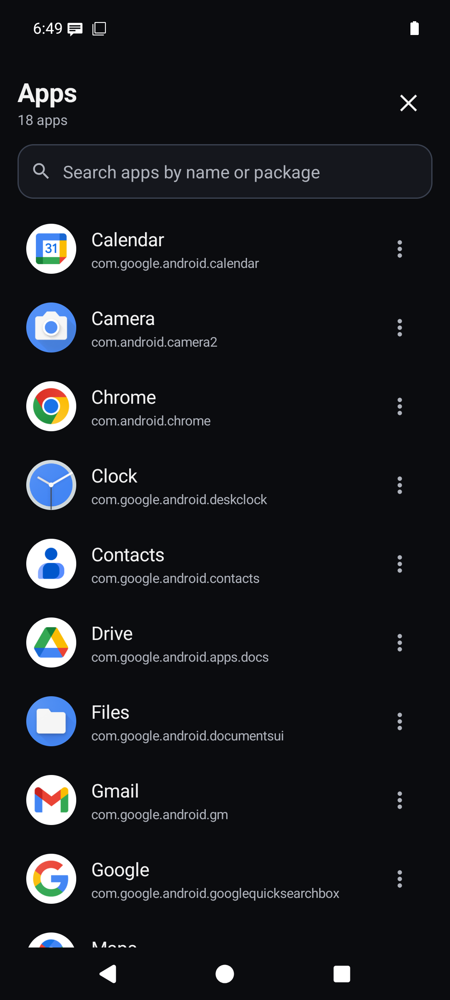

Search by app label or package name. For example, `Settings` and `com.android.settings` find the same app.

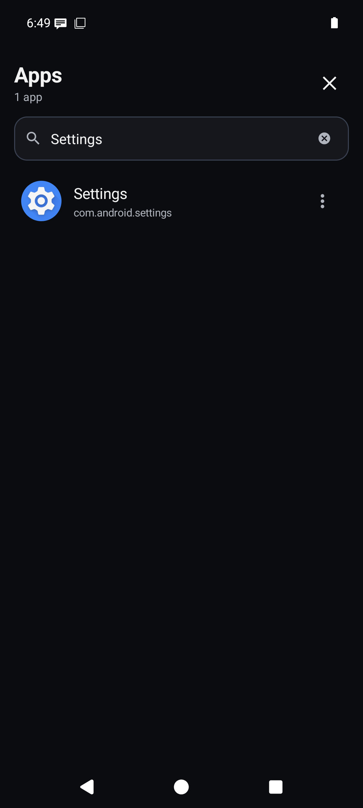

Tap an app to open it. Successful launches do not show a popup; their action, target package and outcome remain in the logs. Launch failures still show feedback. Use its overflow button, or long press its row, for **Add shortcut**, Android **App info**, **Uninstall**, or **Force stop**. Android owns the app-info screen and uninstall confirmation. Force stop needs root. Without root, Dikciz reports `root_unavailable` and does not pretend it worked.

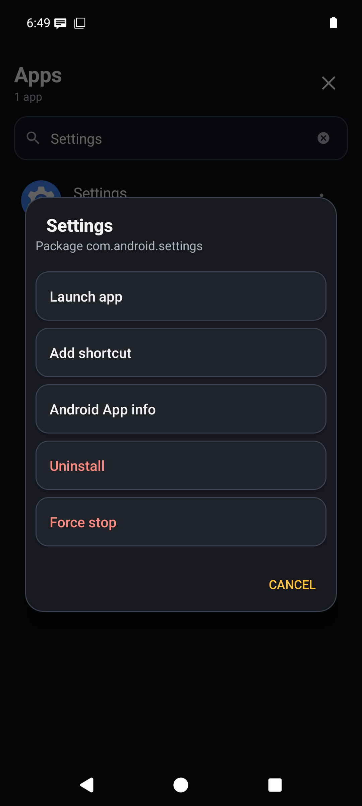

### Add an app shortcut, Dikciz widget, or provider widget

Tap the Dikciz mark and choose **Add to this page**. New items use the next free grid rectangle, from left to right and then top to bottom. Move the item after it appears if you want another position. New app shortcuts appear without a selection outline. Long press one to open its editing controls.

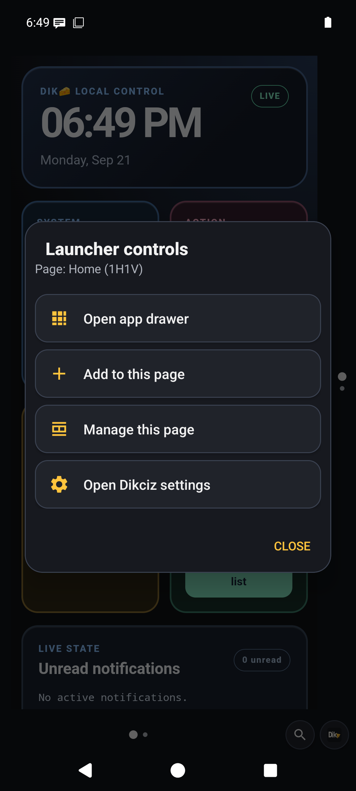

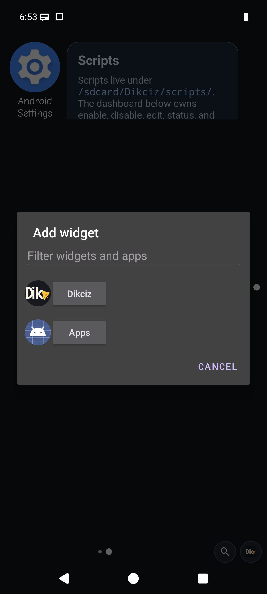

The **Dikciz** category lists complete HTML templates directly, with a description below each title. Search matches titles and descriptions. Tap a template to preview it, then tap **Load** to create an independent widget. **Empty HTML widget** inserts a blank document immediately. The native **Script dashboard** is in the same list. Saved custom templates appear alongside the bundled choices. Choosing a template never adds HTML into an existing widget.

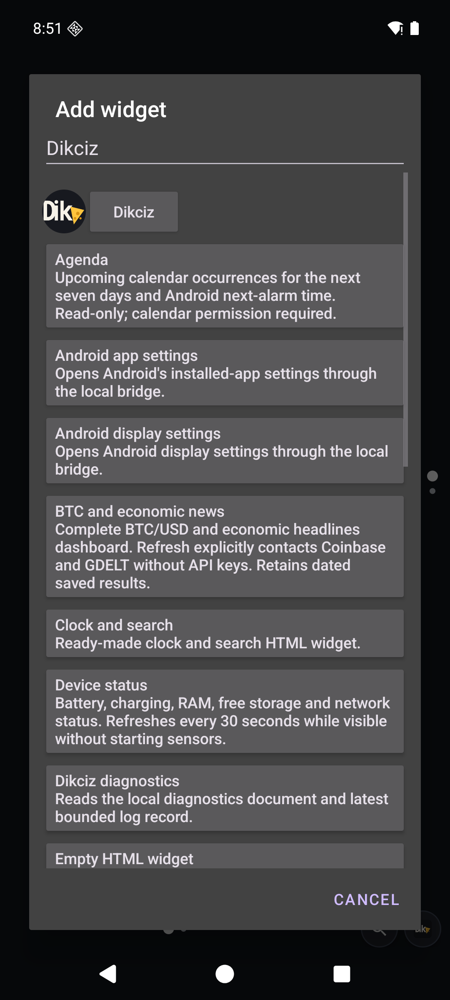

Apps that publish Android widgets have their own category. Dikciz hosts their real Android widget. It does not redraw it or put it inside a WebView.

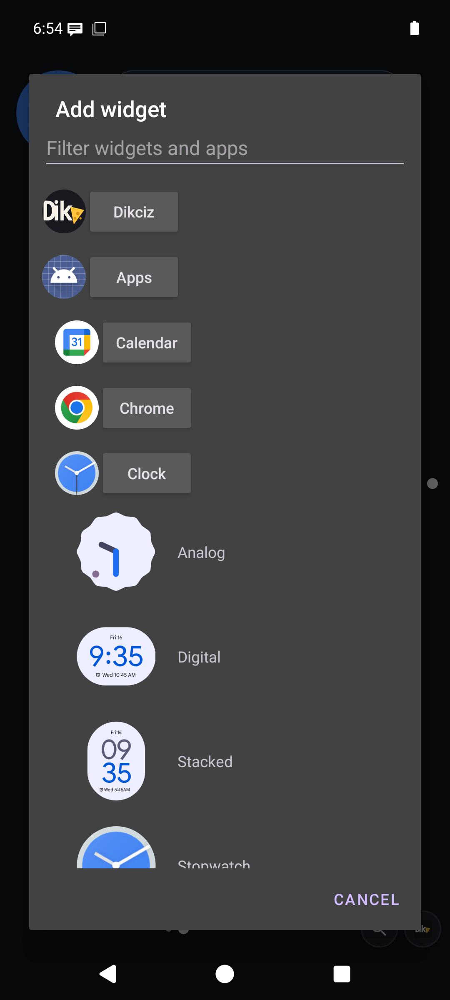

If the page has no free grid rectangle, Dikciz shows a refusal. It does not place a widget off-screen, on top of another widget, or outside the page.

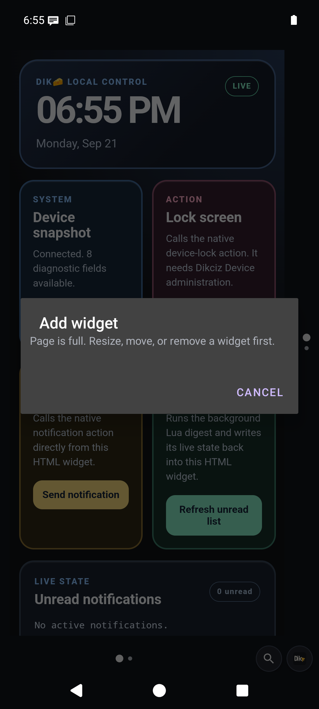

### Move, resize, group, lock, or remove an item

Hold a native app shortcut or app group still for one second, then drag it to move. A swipe before that deadline cancels the move. Hold and release to open edit actions. Long press a native widget, or the top move handle of an HTML widget, for **Move**, **Resize**, **Edit**, **Appearance**, **Fit content**, **Lock**, and **Delete**. The available actions depend on the item type. HTML widgets keep the top 24Dp for moving, while their content keeps normal tap behaviour and item editing.

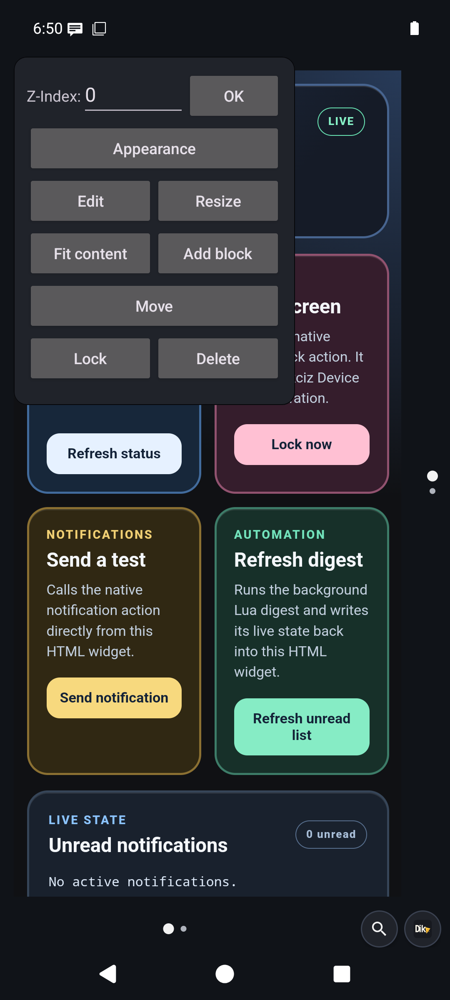

While moving or resizing, the grid stays visible. Drops and resize handles snap to whole cells. A collision is rejected and does not change the saved layout.

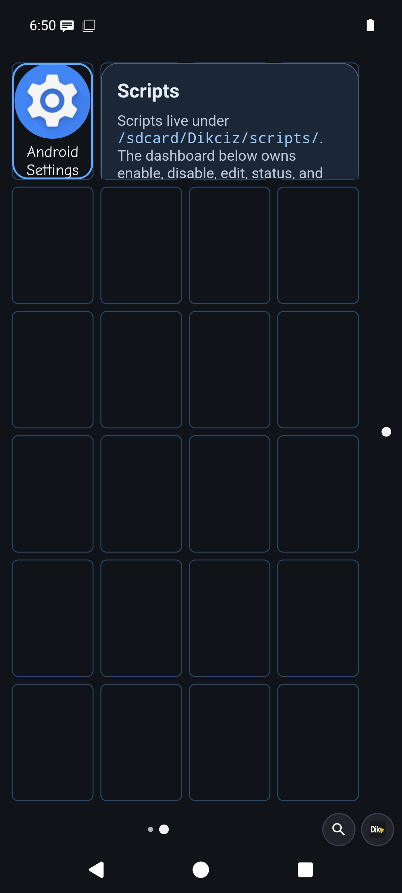

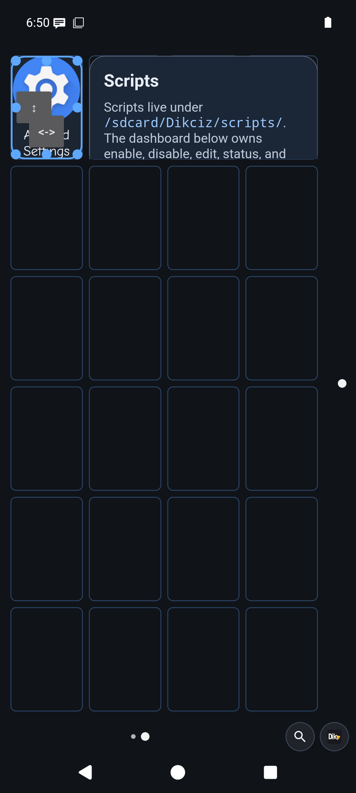

Drop one app shortcut on another to make an app group. Open the group to launch a member. Long press a member to remove it. A group with one member becomes a normal shortcut again.

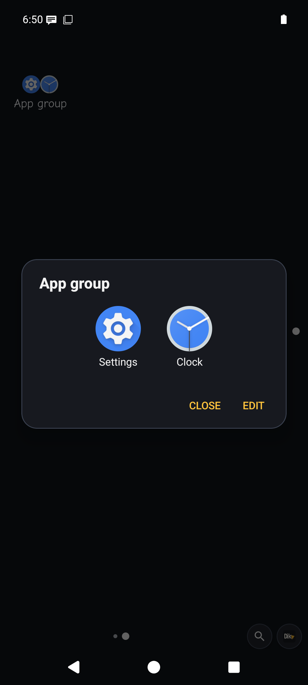

**Delete** removes the widget and its Dikciz-owned public file. Use it only when you want to remove that widget.

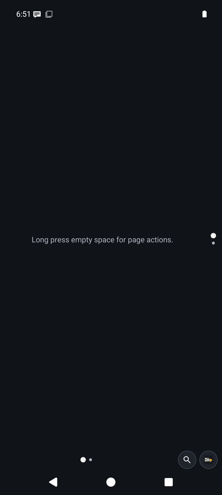

## Build an HTML dashboard

### Edit an HTML widget

Long press the move handle at the top of an HTML widget, choose **Edit**, then change its title, HTML, CSS, JavaScript, or JSON state. The editor contains the source that widget runs.

An HTML widget is one programmable document. Long press anywhere in its content or background to open the same whole-widget controls. **Edit** exposes all HTML, CSS, JavaScript and JSON state. To change one section, edit its markup and the code that renders it. **Delete** removes the entire WebView widget; it never means delete the section under your finger. Page and widget locks protect editing.

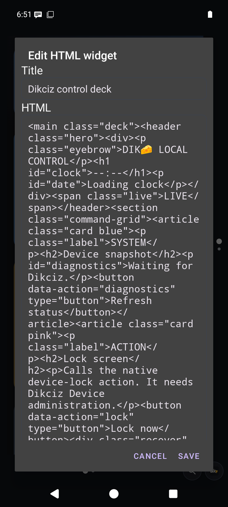

Save the change. Dikciz validates it and updates the running widget in place.

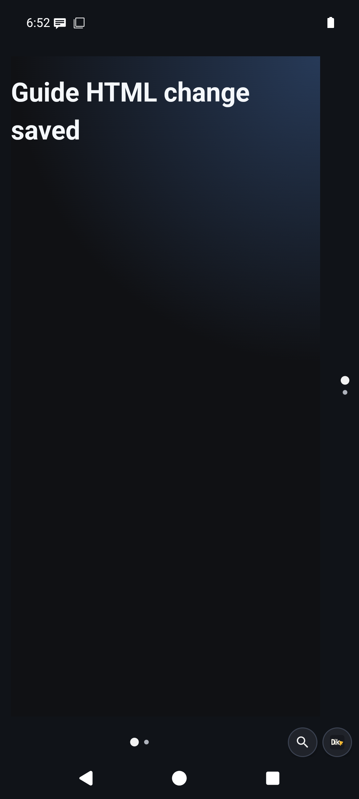

Use **Appearance** to set its background, border, corner radius, spacing, and font. Under **Border**, set **Widths / All sides** to `0` to remove the outer widget border. If the widget or theme sets individual widths, enable **Set individual edges** and set all four sides to `0` too. Borders inside the HTML are part of its CSS. HTML widgets hide scrollbars while keeping their content scrollable. An inherited field continues to follow the active theme.

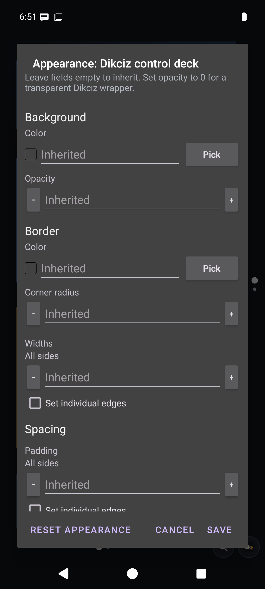

### Reuse a complete WebView template

Open the page's widget picker, expand **Dikciz** and choose a complete template directly. The starter templates are **Time and weather**, **Most used apps**, **Agenda**, **Voice notes** and **Device status**. **Home dashboard** remains an optional combined clock, app search and note document. **System dashboard** displays local RAM, storage, battery, CPU samples and sensor inventory. **Live sensors** displays actual hardware samples and explicit unavailable states. **BTC and economic news** fetches price and headlines when you tap Refresh. Each template supplies the entire HTML, CSS and JavaScript document; the placed widget owns its state.

To reuse your own document, open **Edit**, enter a package ID, and use **Save to library**. Adding that package creates another independent WebView. Edit the new widget's complete source to customize it. Live state is not copied into the library.

Inside an HTML widget, use `selfWidget` to refer to the widget itself even after you move it. Use `dikciz.pages()` when you need the page map or another widget. The [scripting tutorial](scripting-tutorial.md) explains bridge APIs, state, events, and cross-widget work. [Automation control](automation-control.md) is the protocol reference.

## Run scripts and see what they did

### Open, enable, and run a script

Lua scripts are background automation, not widgets. Open **Settings**, then **Scripts**. The script dashboard shows each script's status, most recent run, enable state, and logs.

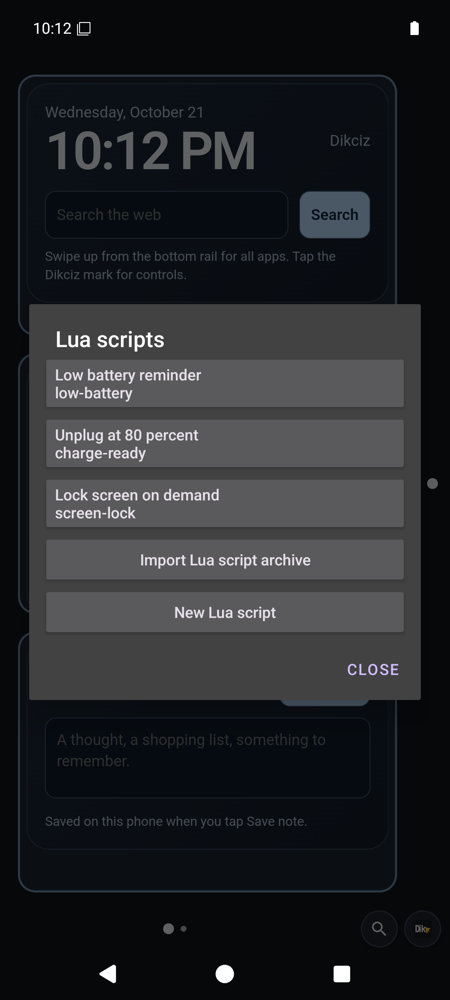

Open the bundled `low-battery` script to view its source, policy, state, and enable control. A policy blocks an action that is missing from its capability list. Dikciz records `capability_denied` in the script log rather than silently ignoring it.

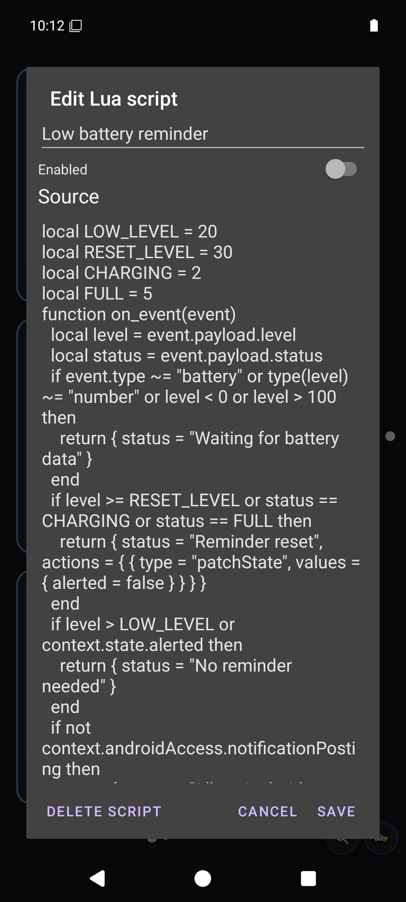

### Grant the Android access an automation needs

Open **Settings**, then **Automation**, then **Set up full device access**. The dedicated setup screen shows active and missing Android permissions and special accesses. Tap the next setup button or choose an individual missing access to open its Android panel. Return with Back to refresh the checklist. If another app takes the foreground, reopen **Full device access** from Recents to continue. Android can recreate the screen without losing the setup route. Android makes the final decision. SMS automation uses read, receive and send SMS permissions. Setup does not request replacing your default messaging app.

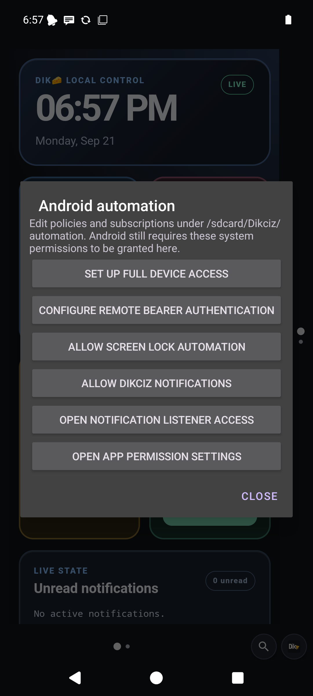

The battery reminders start disabled. Enable one after granting notification-posting access. It reacts to Android battery changes and records its result. Open **Settings**, **Script logs** to inspect outcomes and failures.

The [scripting tutorial](scripting-tutorial.md) walks through subscriptions, policies, custom events, HTML bridge use, typed actions, and logs.

### React to a battery event

The bundled battery reminders are event driven and start disabled. They listen to Android battery changes only after you enable them. They do not depend on a widget remaining on your home.

## Change themes, recover, and connect another machine

### Change theme or inspect launcher settings

Settings contains the grid controls, themes, remote-control settings, diagnostics, script tools, reset, and safe mode.

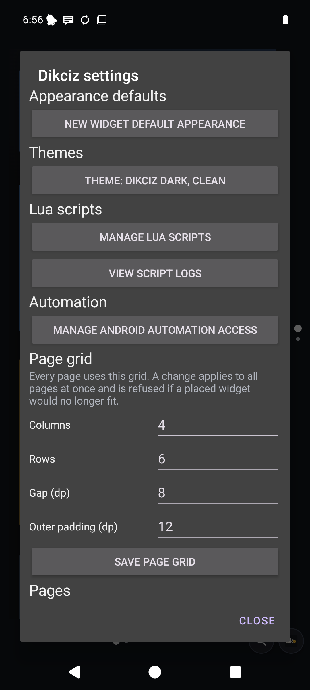

Choose a theme to apply its saved colors, fonts, and style defaults. Applying a theme clears the launcher background override, appearance defaults, and every widget style override. Edit individual widget appearance afterwards to customize it.

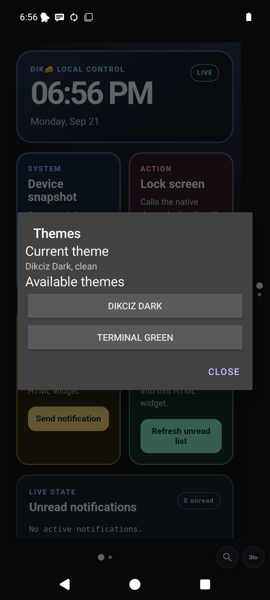

### Recover from a broken configuration

**Reset Dikciz home** replaces the current Dikciz home with the bundled home, scripts, and policies. **Safe mode** starts the bundled home without overwriting your files. Use safe mode when a broken configuration stops the normal home from opening, then repair or replace the files below `/sdcard/Dikciz/`.

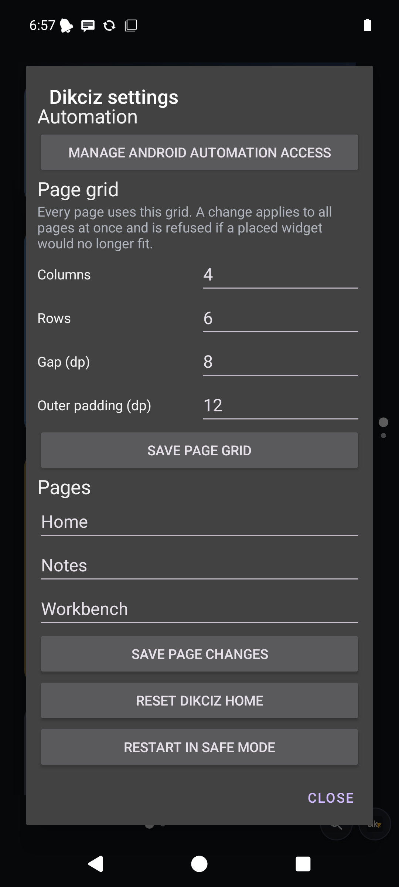

### Connect Dikciz to a computer

Open **Settings**, then **Automation**, to configure the WebSocket and MCP listen address and ports and set, replace, clear, enable, or disable their optional bearer password. The password protects remote connections only. Changing or clearing it on the phone does not require knowing the old password.

The interfaces default to the phone's loopback address. Choose a network listen address, such as `0.0.0.0` for all IPv4 interfaces, to connect directly over a reachable private network or VPN. ADB forwarding remains available with the default loopback binding. The technical commands, protocol, event stream, remote authentication, logs, screenshots, UI inspection, and configuration actions are documented in [automation control](automation-control.md).

### Connect without keeping a USB cable attached

Connect the phone and controlling computer to your private network or Tailscale network. In **Settings**, **Automation**, set and enable a remote bearer password, then open **Configure control ports**, enter `0.0.0.0` as the listen address and save. Connect the computer's client to the phone's private hostname or IP on device ports `19001` for WebSocket and `19002` for MCP. The network policy must allow traffic from that computer to the phone. `0.0.0.0` means listen on all IPv4 interfaces; it is not the hostname to enter in the computer's client.

Saving a changed endpoint closes existing connections, so reconnect with the new settings. Keep `127.0.0.1` if you prefer ADB forwarding. The [USB-free walkthrough](automation-control.md#connect-without-usb) covers client commands, password handling, network exposure and troubleshooting.

### Transfer files, install APKs and run commands

A connected client can browse and transfer files anywhere Android lets Dikciz access. MCP tools and WebSocket or HTTP commands can upload a standalone APK, request Android installation and read the final result. Grant installation from Dikciz and approve the installer prompt on the phone when Android asks. Shell commands return output and exit status; set `root: false` for ordinary app access. The [files, APKs and shell guide](files-and-apks.md) provides examples. Plain HTTP shares the MCP port.

### Choose log detail and retention

Open **Settings**, **Configure logging**. Choose **DEBUG**, **INFO**, **WARN** or **ERROR**, set retention from 1 to 90 days, then save. Changes apply immediately. Defaults are INFO and seven days. DEBUG includes all four levels; each other setting includes its own level and more severe levels. Cancel leaves the saved settings unchanged.

Dikciz appends structured records to `/sdcard/Dikciz/logs/YYYY-MM-DD.log`, using UTC dates and full timestamps within each file. **View logs** shows recent records, including app-action targets and outcomes. WebSocket `scriptLogs` and MCP `dikciz_script_logs` return the same bounded records. Credentials remain redacted at every level.

## Edit the public files directly

All user-editable files live below `/sdcard/Dikciz/`. `config.json` is the root. Pages, widgets, themes, fonts, wallpapers, HTML packages, scripts, policies, remote-auth settings, and logs each have their own directory. Valid configuration and rendering-asset changes reload automatically. Direct edits to `control/ports.json` automatically restart both listeners when the listen address or ports change. Other valid file edits refresh their owning component. An invalid file leaves the last accepted home running and adds the reason to the local log.

Use a file manager on the phone, an ADB connection, or a remote-control client to edit those files. The [configuration guide](dikciz-configuration.md) lists every path, field, validation rule, and recovery path.

## Review remote permission requests

A controller can ask for one Android permission or special access. Dikciz names it in a notification and an in-app dialog. Tap **Allow access** to open the relevant Android permission screen. Grant only access you want the controller to have. If notifications are disabled, open Dikciz to see the pending request. Closing the dialog grants nothing. Granting access never runs the original operation automatically; the controller checks access and retries it.
